# TP Final — RISC-V de 5 etapas con Debug Unit por UART

Guía de estudio unificada: marco teórico, pipeline, ALU del TP1, UART del TP2, Debug Unit, memorias, pruebas, decisiones y plan. Es la versión de texto de la guía interactiva. Los simuladores viven en el HTML; acá los reemplazan diagramas (Mermaid, que GitHub dibuja solo) y tablas de ocupación. Los diagramas de diseño en SVG están en el [README](README.md).

**Convenciones del TP:** HALT = `ebreak` (0x00100073), acordado con el profe. UART 9600 baudios, 8N1 (el TP2 propio). Little-endian.

## Índice

- [Etapa 0 — Empezá acá](#etapa-0--empezá-acá)
- [Etapa 1 — La película completa](#etapa-1--la-película-completa)
- [Etapa 2 — Bits, bytes y palabras](#etapa-2--bits-bytes-y-palabras)
- [Etapa 3 — El reloj y el enable](#etapa-3--el-reloj-y-el-enable)
- [Etapa 4 — El pipeline en vivo](#etapa-4--el-pipeline-en-vivo)
- [Etapa 5 — Laboratorio del pipeline](#etapa-5--laboratorio-del-pipeline)
- [Etapa 6 — Qué viaja entre etapas](#etapa-6--qué-viaja-entre-etapas)
- [Etapa 7 — La ALU (TP1)](#etapa-7--la-alu-tp1)
- [Etapa 8 — La UART (TP2)](#etapa-8--la-uart-tp2)
- [Etapa 9 — La Debug Unit](#etapa-9--la-debug-unit)
- [Etapa 10 — Memorias](#etapa-10--memorias)
- [Etapa 11 — Cómo se prueba todo](#etapa-11--cómo-se-prueba-todo)
- [Etapa 12 — Las decisiones (ADR)](#etapa-12--las-decisiones-adr)
- [Etapa 13 — El plan de trabajo](#etapa-13--el-plan-de-trabajo)
- [Etapa 14 — Lo que falta decidir](#etapa-14--lo-que-falta-decidir)
- [Etapa 15 — Autoevaluación](#etapa-15--autoevaluación)
- [Diccionario](#diccionario)
- [Apéndice A — Registros de segmentación](#apéndice-a--qué-lleva-cada-registro-de-segmentación)
- [Apéndice B — Formatos RV32I](#apéndice-b--formatos-de-instrucción-rv32i)
- [Apéndice C — Debug Unit y protocolo](#apéndice-c--debug-unit-y-protocolo)

---

# Etapa 0 — Empezá acá

> **En una frase:** Vas a construir un procesador que corre programas dentro de la FPGA, y una forma de controlarlo desde la PC por el cable USB.

Este documento junta todo en un solo lugar: el plan de tu compañero, la guía anterior y tus TP1 y TP2. Nada de saltar entre PDFs.

### Cómo usarla

- Cada etapa tiene **una sola idea**. No hace falta leerla toda de una.
- Las palabras técnicas están definidas en el [Diccionario](#diccionario), en orden alfabético.
- Los apéndices son la referencia rápida: qué lleva cada registro de pipeline, los formatos de instrucción y el protocolo.

> **Qué ya tenés hecho:** **TP1**: una ALU que suma, resta, hace AND/OR/XOR y desplaza. **TP2**: una UART que recibe y manda bytes, y una máquina de estados que los interpreta. El TP final reutiliza las dos.

### El objetivo, en tres piezas

- **1. Procesador:** Un RISC-V de 5 etapas que ejecuta 32 instrucciones + una para parar.
- **2. Debug Unit:** Un módulo que recibe órdenes por UART: cargar programa, correr, dar un paso, devolver el estado.
- **3. Software de PC:** Convierte tu programa en números, se los manda a la placa y muestra qué pasó.

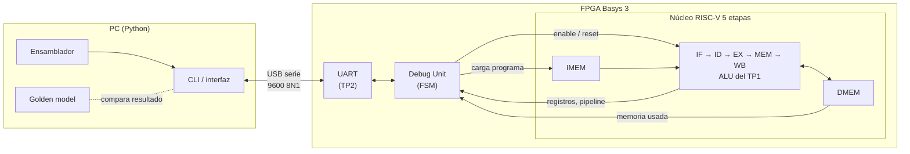

---

# Etapa 1 — La película completa

> **En una frase:** Escribís un programa, viaja como bytes por el cable, la placa lo ejecuta y te devuelve una foto del estado para comparar.

Lo que lleva etiqueta TP1 o TP2 ya lo hiciste vos.

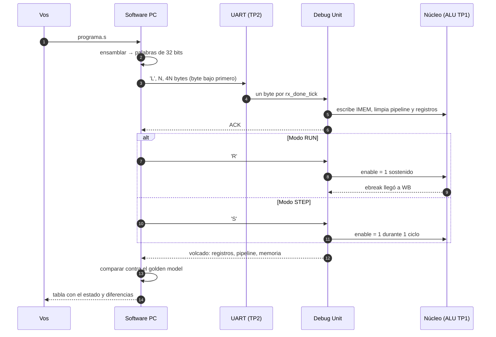

> **Dos modos de ejecutar:** **RUN**: la placa corre todo el programa sola hasta el ebreak. **STEP**: avanza un solo ciclo y te manda la foto. Ambos tienen que dar el mismo resultado final.

> **La regla que ordena todo:** El reloj **nunca se toca**. Para "pausar" el procesador se usa una señal enable. Lo vemos en la etapa 3.

---

# Etapa 2 — Bits, bytes y palabras

> **En una frase:** Un bit es un 0 o 1. 8 bits forman un byte. 4 bytes forman una palabra (word) de 32 bits, y cada instrucción es una palabra.

- **bit:** Un 0 o un 1.
- **byte:** 8 bits. Va de 0 a 255. Es lo que viaja por la UART de a uno.
- **palabra (word):** 32 bits = 4 bytes. Un registro del procesador guarda una palabra. Una instrucción ocupa una palabra.

### 1. De palabra a bytes (little-endian)

La palabra `0x11223344` se guarda y se manda con el byte menos significativo primero:

```
palabra:     0x 11 22 33 44
                │  │  │  └──────────────┐
                │  │  └───────────┐     │
                │  └────────┐     │     │
                └─────┐     │     │     │
                      ▼     ▼     ▼     ▼
dirección:          +3    +2    +1    +0
memoria:            11    22    33    44

por la UART (en el tiempo) ──►  44 → 33 → 22 → 11
```

### 2. De palabra a instrucción

Una instrucción es una palabra partida en campos. El opcode dice de qué tipo es; el resto dice con qué registros y números trabaja.

**`addi x1, x0, 5` = `0x00500093` (tipo I)**

```
 31                  20 19   15 14 12 11    7 6      0
┌──────────────────────┬───────┬─────┬───────┬────────┐
│     000000000101     │ 00000 │ 000 │ 00001 │0010011 │
│      imm = 5         │ rs1=x0│ addi│ rd=x1 │ OP-IMM │
└──────────────────────┴───────┴─────┴───────┴────────┘
```

**`sw x5, 8(x2)` = `0x00512423` (tipo S): el inmediato viene en dos pedazos**

```
 31     25 24   20 19   15 14 12 11    7 6      0
┌─────────┬───────┬───────┬─────┬───────┬────────┐
│ 0000000 │ 00101 │ 00010 │ 010 │ 01000 │0100011 │
│imm[11:5]│ rs2=x5│ rs1=x2│ sw  │imm[4:0]│ STORE │
└─────────┴───────┴───────┴─────┴───────┴────────┘
   imm = 0000000 ++ 01000 = 8
```

**`bne x1, x2, -8` = `0xFE209CE3` (tipo B): el inmediato viene en dos pedazos y desordenado**

```
 31  30    25 24   20 19   15 14 12 11   8   7  6      0
┌───┬────────┬───────┬───────┬─────┬──────┬───┬────────┐
│ 1 │ 111111 │ 00010 │ 00001 │ 001 │ 1100 │ 1 │1100011 │
│i12│i[10:5] │ rs2=x2│ rs1=x1│ bne │i[4:1]│i11│ BRANCH │
└───┴────────┴───────┴───────┴─────┴──────┴───┴────────┘
   imm = i12 i11 i[10:5] i[4:1] 0 = 1 1 111111 1100 0 = -8
```

> **Trampa clásica:** En los saltos y stores el inmediato viene **partido en dos pedazos** dentro de la palabra. El ensamblador y el generador de inmediatos (`imm_gen`) tienen que armarlo igual.

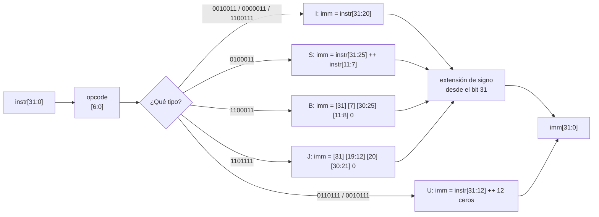

---

# Etapa 3 — El reloj y el enable

> **En una frase:** El reloj late siempre. Un cable `enable` decide si los registros le hacen caso a cada latido o lo ignoran.

El enunciado dice "ejecutar un ciclo por comando" y también "no tocar el clock". Se resuelve así: el reloj no se toca, y el procesador avanza solo cuando `enable` vale 1.

```verilog
always @(posedge clk)
  if (reset)       pc <= 0;
  else if (enable) pc <= pc_next;   // si enable = 0, se queda igual
```

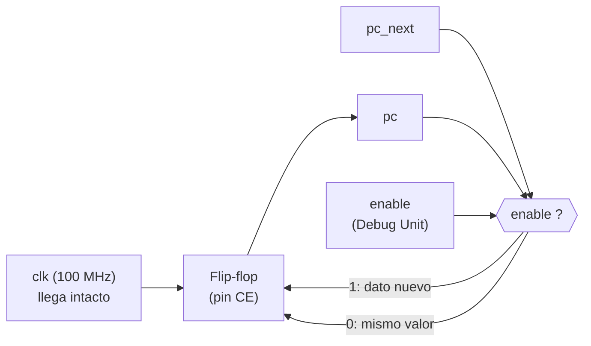

> **Lo prohibido:** El clock gating (meter una compuerta en el reloj) mete skew y pulsos falsos. Por eso el enunciado lo prohíbe. El enable es un pin del propio flip-flop: el reloj llega intacto.

```
 PROHIBIDO                           CORRECTO
 clk ──┐                             clk ─────────────► CLK  FF
       AND ──► CLK  FF               enable ──────────► CE   FF
 en  ──┘   (skew, glitches)          (el reloj no pasa por lógica)
```

### ¿Y el STEP?

STEP = `enable` en 1 durante **exactamente un ciclo**.

```
ciclo       1     2     3     4     5     6
clk       ┌┐ ┌┐ ┌┐ ┌┐ ┌┐ ┌┐ ┌┐ ┌┐ ┌┐ ┌┐ ┌┐ ┌┐
          ┘└─┘└─┘└─┘└─┘└─┘└─┘└─┘└─┘└─┘└─┘└─┘└─
enable    ______________┌─────┐________________
                        └ 1 ciclo ┘
pc        ═══ 0x08 ═════════════╳═══ 0x0C ══════
                                ▲
                  único flanco con enable = 1
```

---

# Etapa 4 — El pipeline en vivo

> **En una frase:** Cinco instrucciones están en obra a la vez, cada una en una etapa distinta. A veces una tiene que esperar a otra.

Es una línea de armado: mientras una instrucción se calcula, la siguiente se decodifica y la siguiente se busca.

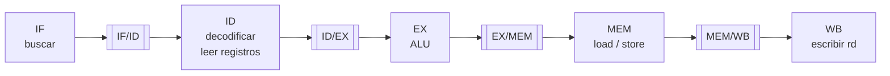

**Ideal (sin riesgos): una instrucción termina por ciclo**

| Instr. \ Ciclo | 1 | 2 | 3 | 4 | 5 | 6 | 7 |
|---|---|---|---|---|---|---|---|
| i1 | IF | ID | EX | MEM | WB | | |
| i2 | | IF | ID | EX | MEM | WB | |
| i3 | | | IF | ID | EX | MEM | WB |

### Los tres problemas (riesgos)

- **De datos:** Una instrucción necesita un resultado que otra todavía no terminó. Solución: forwarding (atajo) o stall (esperar).
- **De control:** Un salto cambia el camino, pero ya buscaste instrucciones del camino equivocado. Solución: flush (descartarlas).
- **Estructural:** Dos etapas quieren el mismo recurso. Solución: memorias separadas y banco de registros con bypass interno.

### 1) `add x1,..` → `sub x2,x1,..` **sin forwarding**

`sub` espera en ID hasta que `add` escribe x1 en WB (el bypass interno del banco le deja leerlo en el mismo ciclo 5).

| Instr. \ Ciclo | 1 | 2 | 3 | 4 | 5 | 6 | 7 | 8 |
|---|---|---|---|---|---|---|---|---|
| `add x1,x3,x4` | IF | ID | EX | MEM | **WB** | | | |
| `sub x2,x1,x5` | | IF | ID | *stall* | *stall* | EX | MEM | WB |

→ **2 ciclos de espera.**

### 2) El mismo programa **con forwarding**

| Instr. \ Ciclo | 1 | 2 | 3 | 4 | 5 | 6 |
|---|---|---|---|---|---|---|
| `add x1,x3,x4` | IF | ID | EX | **MEM** | WB | |
| `sub x2,x1,x5` | | IF | ID | **EX** ◄ fwd EX/MEM | MEM | WB |

→ **0 ciclos de espera.**

### 3) `lw` → `add`: load-use

El dato del `lw` recién existe al final de MEM. Aunque haya forwarding, queda **1 ciclo de espera**.

| Instr. \ Ciclo | 1 | 2 | 3 | 4 | 5 | 6 | 7 |
|---|---|---|---|---|---|---|---|
| `lw x1,0(x2)` | IF | ID | EX | MEM | **WB** | | |
| `add x3,x1,x4` | | IF | ID | *stall* (burbuja en EX) | **EX** ◄ fwd MEM/WB | MEM | WB |

### 4) Branch tomado, resuelto en EX: flush de 2

| Instr. \ Ciclo | 1 | 2 | 3 | 4 | 5 | 6 | 7 |
|---|---|---|---|---|---|---|---|
| `beq x1,x2,dest` | IF | ID | **EX** (tomado) | MEM | WB | | |
| `i+1` | | IF | ID | ~~flush~~ | | | |
| `i+2` | | | IF | ~~flush~~ | | | |
| `dest:` | | | | IF | ID | EX | MEM |

### 5) HALT (`ebreak`): se detecta en ID y el pipeline se vacía

| Instr. \ Ciclo | 1 | 2 | 3 | 4 | 5 | 6 | 7 |
|---|---|---|---|---|---|---|---|
| `addi x1,x0,5` | IF | ID | EX | MEM | WB | | |
| `ebreak` | | IF | **ID** (halt) | EX | MEM | **WB** → fin | |
| siguiente | | | IF | ~~descartada~~ | | | |
| (IF frenado) | | | | — | — | — | |

> **Probá esto en el laboratorio:** 1) "add → sub" con forwarding apagado: aparecen ciclos de espera. 2) Prendelo: desaparecen. 3) "lw → add": aunque tengas forwarding, queda **1 ciclo de espera** (load-use).

---

# Etapa 5 · Laboratorio — Laboratorio del pipeline

> **En una frase:** Escribís un programa y lo ves correr ciclo a ciclo, con todo lo que pasa adentro: qué hay en cada etapa, quién espera, quién se descarta y qué valen los registros.

### Para qué sirve esto en el TP

El objetivo final del TP es exactamente esto, pero en la placa: cargás un programa por la UART, lo corrés **de a un ciclo** y la PC te muestra el pipeline, los registros y la memoria. El laboratorio (en la guía HTML) es la versión de práctica: lo mismo que vas a ver en tu interfaz, pero sin Verilog ni cables.

- **Lo que se ve:** etapas, stall, flush, forwarding, registros de segmentación, banco de registros, memoria de datos, CPI.
- **Dónde aparece en el TP:** es lo que la Debug Unit te manda en el volcado: registros, memoria y los registros entre etapas.

### Cómo leer la pantalla (4 cosas, en este orden)

1. **Las cinco cajas de arriba:** qué instrucción está en cada etapa *ahora*.
2. **La lista de abajo, en criollo:** qué pasó en este ciclo y por qué. Si algo se frena o se descarta, acá está la razón.
3. **La tabla de ocupación:** una fila por instrucción, una columna por ciclo (como las de la etapa 4). Se lee de izquierda a derecha como una película.
4. **Registros y memoria:** lo que de verdad cambia. Lo que se acaba de escribir se marca en verde.

> **Colores:** verde = avanza normal · amarillo = frenada (stall) · azul = usa forwarding · rojo = descartada (flush)

### Qué simplifica el laboratorio

> **Ojo:**
> - Usa `halt` como pseudo-instrucción. En tu TP el HALT es `ebreak` (0x00100073).
> - Solo tiene un subconjunto de instrucciones: no hay desplazamientos, `lui`, `jal` ni accesos de byte.
> - Las direcciones de memoria son enteros simples, sin las reglas de alineación del TP.
> - Frena la búsqueda cuando *busca* el HALT. En tu núcleo la detección es en ID y hay que descartar lo que venga detrás (HALT especulativo).

---

# Etapa 6 — Qué viaja entre etapas

> **En una frase:** Entre dos etapas hay un registro de segmentación (el "latch" del enunciado) que guarda todo lo que la instrucción necesita para seguir viaje.

> **No son latches reales:** El enunciado les dice "latches" pero son bancos de flip-flops. No los confundas con un latch de verdad ni con un latch inferido (un error).

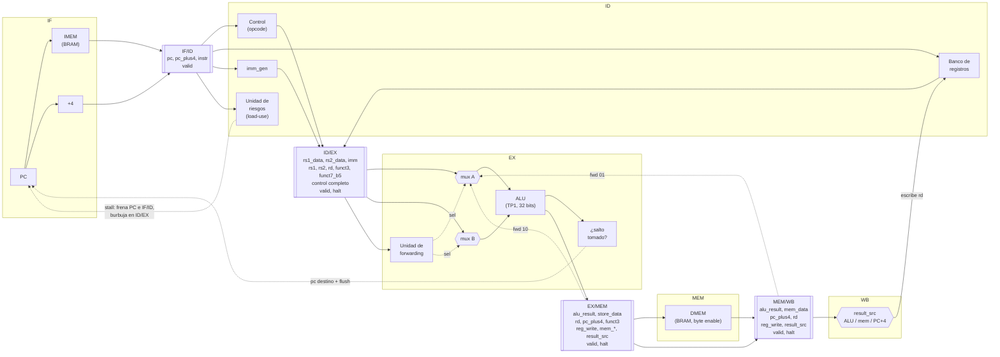

El detalle de cada campo está en el [Apéndice A](#apéndice-a--qué-lleva-cada-registro-de-segmentación).

> **Dos ideas:**
> - El **control viaja con la instrucción**: se calcula en ID y acompaña a la instrucción hasta la etapa que lo usa.
> - El bit `valid` distingue una burbuja de una instrucción real. Una burbuja **nunca escribe** registros ni memoria.

**Cómo se "gasta" el control a lo largo del pipeline:**

```
             ID/EX            EX/MEM           MEM/WB
           ┌──────────┐     ┌──────────┐     ┌──────────┐
 EX   usa  │ alu_src  │     │          │     │          │
           │ alu_op   │     │          │     │          │
           │ branch   │     │          │     │          │
           │ jump/jalr│     │          │     │          │
           ├──────────┤     ├──────────┤     │          │
 MEM  usa  │ mem_read │ ──► │ mem_read │     │          │
           │ mem_write│     │ mem_write│     │          │
           ├──────────┤     ├──────────┤     ├──────────┤
 WB   usa  │ reg_write│ ──► │ reg_write│ ──► │ reg_write│
           │result_src│     │result_src│     │result_src│
           └──────────┘     └──────────┘     └──────────┘
```

---

# Etapa 7 · TP1 — La ALU (tu TP1)

> **En una frase:** La ALU es la calculadora del procesador. La tuya del TP1 sirve; hay que pasarla a 32 bits y agregarle 3 operaciones.

### Qué cambia respecto del TP1

|  | TP1 | TP final |
|---|---|---|
| Ancho | parametrizable (8 en TP2) | 32 bits |
| Operaciones | ADD SUB AND OR XOR NOR SRL SRA | ADD SUB AND OR XOR SLL SRL SRA **SLT SLTU** (NOR sobra) |
| Banderas | zero, carry, overflow | solo **zero** (para beq/bne) |
| Desplazar | desplaza `b` según `a` | desplaza **rs1** según **rs2**: invertir operandos |
| Código de operación | 6 bits de la cátedra | 4 bits que genera `alu_control` |

### El control en dos niveles

La unidad de control mira el opcode y dice `alu_op` (2 bits). Después `alu_control` mira `alu_op` + funct3 + funct7 y elige la operación.

- **00:** sumar (loads, stores, jalr)
- **01:** restar (beq, bne)
- **10:** R-type: mirar funct3 y funct7
- **11:** I aritmético: mirar funct3

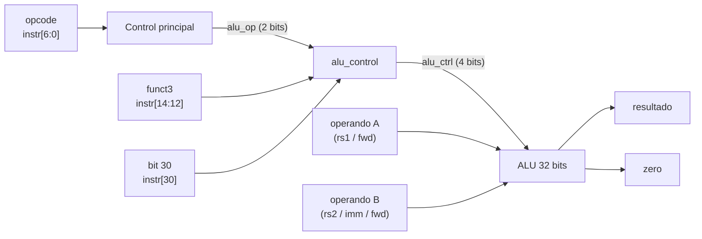

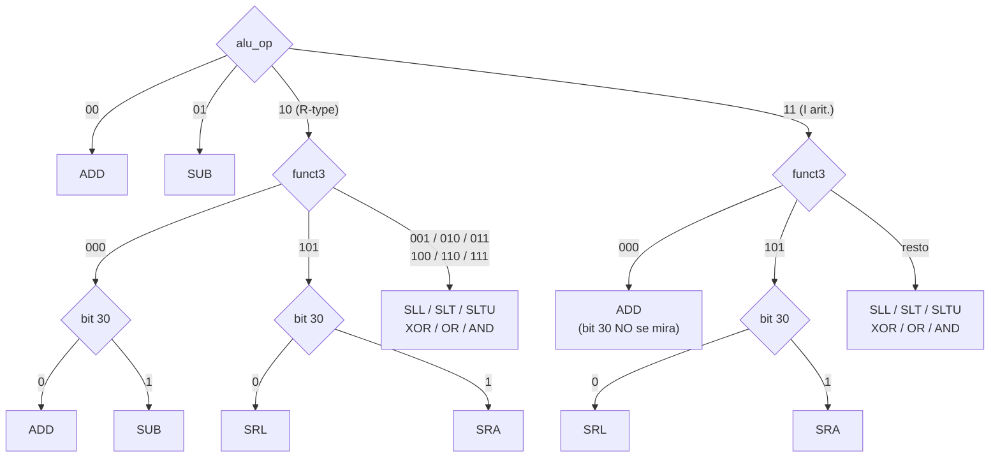

> **Trampa: addi con inmediato negativo:** El bit 30 en una R-type distingue add de sub. En una I-type ese bit es parte del número. Si `alu_control` lo mirara siempre, `addi x1,x0,-1024` se ejecutaría como `sub`. Regla: en I-type solo se mira si funct3 = 101 (srli/srai).

---

# Etapa 8 · TP2 — La UART (tu TP2)

> **En una frase:** La UART manda un byte como una serie de pulsos, uno por vez, a una velocidad acordada (baud rate). Tu TP2 ya hace esto.

**Una trama 8N1 (ejemplo: el byte `0x4C` = `'L'` = 0100 1100):**

```
 reposo  start  b0  b1  b2  b3  b4  b5  b6  b7  stop  reposo
 ──────┐      ┌───────┐       ┌───────┐   ┌───────────────────
       │      │       │       │       │   │
       └──────┘       └───────┘       └───┘
         0     0   0   1   1   0   0   1   0    1
              └──── bit menos significativo primero ────┘
   cada bit dura 1/9600 s ≈ 104 µs  →  10 bits por byte ≈ 1,04 ms
```

### El divisor de baudios

Tu `baudio_generator` cuenta ciclos de reloj para generar un tick 16 veces por bit (sobremuestreo x16). Divisor = redondeo( reloj / (16 × baudios) ).

| Reloj | Baudios | Divisor |
|---|---|---|
| 100 MHz | 9600 | 100 000 000 / 153 600 ≈ **651** |
| 100 MHz | 115200 | 100 000 000 / 1 843 200 ≈ **54** |
| 50 MHz (Clock Wizard) | 9600 | 50 000 000 / 153 600 ≈ **326** |

```
 un bit (16 s_tick)
 │◄──────────────────────────────────────────────►│
 │ t t t t t t t t t t t t t t t t                │
                 ▲
       muestra en el tick 8 (centro del bit)
```

> **Por qué importa en el TP final:** Si el Clock Wizard cambia la frecuencia del procesador, hay que cambiar `CLK_FREQ` en el `top`. Si no, la UART queda con otra velocidad y la PC no la entiende.

### Las señales que ya usaste

| Señal | Significado |
|---|---|
| `s_tick` | pulso 16 veces por bit |
| `rx_done_tick` | "llegó un byte, está en `dout`" (pulso de un ciclo) |
| `tx_start` | "mandá el byte que puse en `din`" |
| `tx_done_tick` | "terminé de mandarlo" (pulso) |

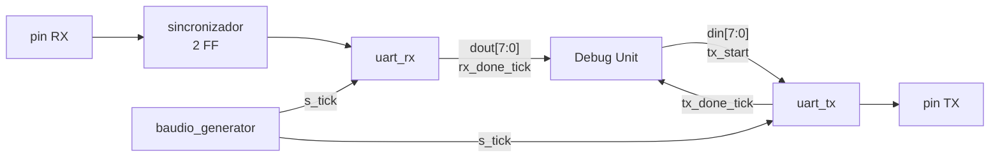

Esa pareja start/done es un handshake. La Debug Unit la usa para pasar bytes sin perder ninguno. Y el sincronizador de 2 flip-flops de tu `uart_rx` evita la metaestabilidad.

---

# Etapa 9 — La Debug Unit

> **En una frase:** Es una máquina de estados que escucha comandos por UART y controla el `enable` del procesador. Es tu `interface_alu` en grande.

Los eventos que no corresponden al estado actual se rechazan con NACK.

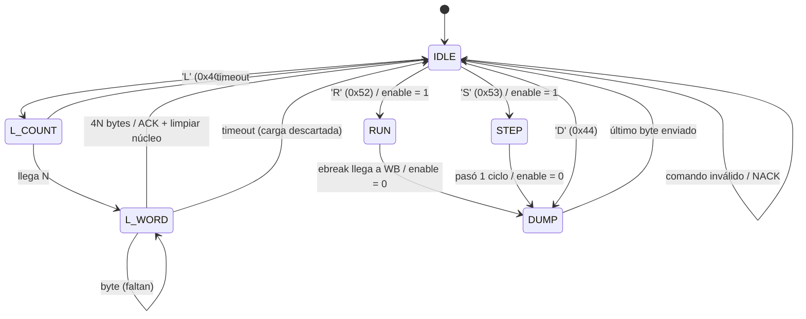

### Es lo mismo que ya hiciste

| interface_alu (TP2) | Debug Unit |
|---|---|
| WAIT_A: espero el primer byte | IDLE: espero un comando |
| WAIT_B, WAIT_OP: más bytes | L_COUNT, L_WORD: recibo N y las palabras |
| SEND + tx_start | mandar ACK o el volcado |
| WAIT_TX + tx_done_tick | esperar antes del siguiente byte |
| timeout de 0,5 s | timeout de una carga cortada |
| default: WAIT_A | ante lo imprevisto, volver a IDLE |

### Cómo se arma una palabra

Los bytes llegan de a uno, el bajo primero. Con `word <= {dout, word[31:8]}` cada byte nuevo entra por arriba y los anteriores bajan. A los 4 bytes, la palabra está en orden.

```
llega     word[31:24] word[23:16] word[15:8] word[7:0]
inicio        --          --          --         --
0x44          44          --          --         --
0x33          33          44          --         --
0x22          22          33          44         --
0x11          11          22          33         44   → 0x11223344 ✔
```

### Cómo se envía el volcado (un byte por handshake)

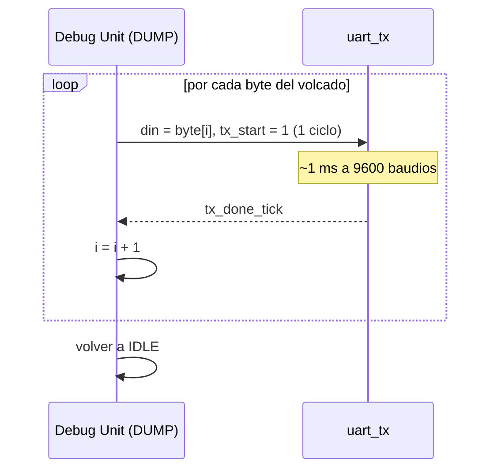

> **Cuidado:** En STEP, el enable vale 1 durante **un solo ciclo**. Si dura 2, el procesador avanza 2 y se rompe la regla "un paso = un ciclo".

---

# Etapa 10 — Memorias

> **En una frase:** La BRAM es memoria grande y barata de la FPGA, pero el dato aparece **un ciclo después** de pedir la dirección.

- **LUTRAM:** lectura combinacional: el dato está en el mismo ciclo. Gasta LUTs. Sirve para memorias chicas.
- **BRAM:** lectura sincrónica: llega al ciclo siguiente. No gasta LUTs. Sirve para las memorias de 1 KiB del TP. No tiene reset.

```
ciclo          1          2          3
clk        ┌──┐  ┌──┐  ┌──┐  ┌──┐  ┌──┐
           ┘  └──┘  └──┘  └──┘  └──┘  └──
addr       ═ A0 ══╳═ A1 ══╳═ A2 ═════
LUTRAM out ═ M[A0]╳═ M[A1]╳═ M[A2]═══   (mismo ciclo)
BRAM out   ══════ ╳═ M[A0]╳═ M[A1]═══   (un ciclo después)
```

> **Qué te cambia en el procesador:** La instrucción llega un ciclo después de que el PC la pide. Hay que alinear PC e instrucción, y frenar el puerto de lectura con `enable`. Si no, durante un STEP la instrucción de IF/ID cambiaría sola.

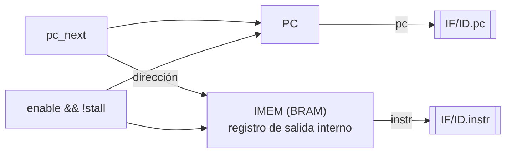

Una forma de alinear: la BRAM se direcciona con `pc_next` (no con `pc`), así el dato que sale en el ciclo siguiente corresponde al PC que se acaba de registrar. El registro de salida de la BRAM funciona como la parte `instr` de IF/ID y usa el mismo `enable`.

### Dual port

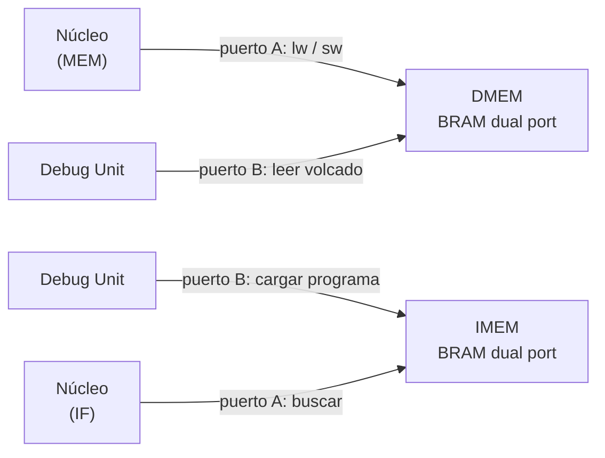

### Otras palabras de memoria

- **Dual port:** dos accesos a la vez (el procesador y la Debug Unit).
- **Byte enable:** escribir un solo byte (`sb`) sin tocar los otros tres.
- **`$readmemh`:** cargar un programa en la memoria dentro de un testbench.

```
sb a dirección 0x...2 (addr[1:0] = 10)     we = 0100
           byte 3   byte 2   byte 1   byte 0
antes:       AA       BB       CC       DD
dato:        --       77       --       --
después:     AA       77       CC       DD
```

---

# Etapa 11 — Cómo se prueba todo

> **En una frase:** Cada módulo tiene un testbench que dice solo PASSED o FAILED, y todo el procesador se compara contra un golden model en software.

- **Módulo por módulo:** Tu `alu_tb` ya hace esto: casos dirigidos + aleatorios + una función `expected_result` + contador de errores. Se repite para cada módulo nuevo.
- **Procesador completo:** Corrés el mismo programa en el golden model (Python, sin pipeline) y en la placa. Si los registros y la memoria coinciden, el hardware está bien.
- **Sin golden model:** Plan B: cada programa escribe una firma de éxito fija en memoria si todo salió bien.

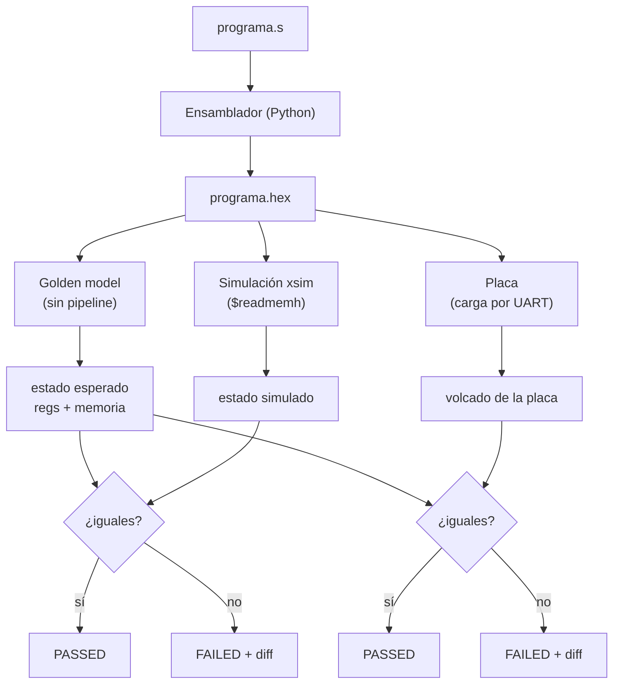

> **Un mini golden model:**
> ```python
> while not halt:
>     w = imem[pc // 4]   # buscar
>     op = w & 0x7F       # decodificar
>     ...                 # ejecutar, sin etapas ni riesgos
>     pc += 4
> ```

### Del AC al testbench

Cada tarea del plan trae criterios de aceptación (AC). Cada AC es una línea de testbench. Ejemplo para el forwarding:

| Situación | Esperado |
|---|---|
| `add x1,..` seguido de `sub x2,x1,..` | fwd_a = 10 (desde EX/MEM) |
| productor a 2 instrucciones | fwd_a = 01 (desde MEM/WB) |
| coinciden los dos | gana EX/MEM |
| destino x0 | nunca reenviar |
| productor es burbuja | no reenviar |

La misma tabla, como la decide la unidad de forwarding (para el operando A; el B es igual con `rs2`):

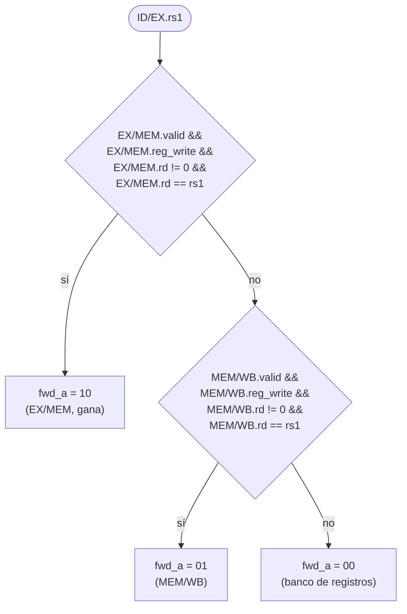

Y la detección de load-use, en ID:

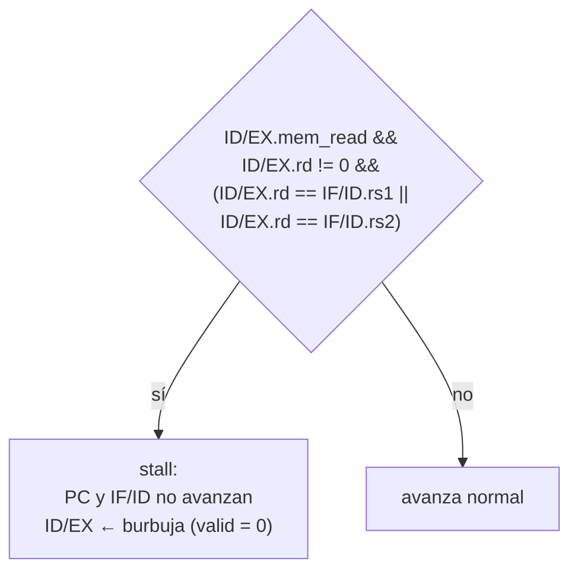

---

# Etapa 12 — Las decisiones (ADR)

> **En una frase:** Una ADR es una hoja corta con una decisión, su porqué y las opciones que descartaste. El informe te las pide.

Cada ADR dice cómo se compara con lo que ya acordamos: **igual**, **distinto** o **falta decidir**.

| ADR | Tema | Estado |
|---|---|---|
| 001 | Un ciclo sin tocar el clock | igual |
| 002 | Velocidad de la UART | falta decidir |
| 003 | Protocolo PC ↔ FPGA | falta decidir |
| 004 | Codificación de HALT | distinto |
| 005 | Memorias | igual |
| 006 | Dónde se resuelve un salto | falta decidir |
| 007 | Riesgos de datos | igual |
| 008 | Tamaño de memorias / memoria usada | igual |
| 009 | Qué limpiar al recargar | igual |
| 010 | Programa sin HALT | igual |
| 011 | Lenguaje del software de PC | igual |
| 012 | Interfaz | falta decidir |
| 013 | Ensamblador | falta decidir |
| 014 | Golden model | igual |
| 015 | Simulador de Verilog | igual |
| 016 | Frecuencia | igual |
| 017 | Serialización del pipeline | falta decidir |
| 018 | Desalineados, endianness, ilegales | igual |
| 019 | Reutilizar la ALU del TP1 | distinto |
| 020 | Versión de Vivado | igual |

**`ADR-001` Cómo hacer "un ciclo" sin tocar el clock — igual**

**El plan recomienda:** Un enable global al núcleo. Sin clock gating.

**Para nosotras:** Igual. Es la base de todo.

Alternativas: compuerta AND en el reloj (prohibido) o BUFGCE (válido pero se lee como "tocar el clock"). Costo: el enable tiene fan-out alto.

**`ADR-002` A qué velocidad habla la UART — falta decidir**

**El plan recomienda:** Subir a 115200 y validar la paridad.

**Para nosotras:** Nuestra UART es 9600 sin paridad. Cambiar de velocidad es cambiar un parámetro; decidir si hace falta.

A 9600 un volcado grande tarda medio segundo. El divisor se calcula con la fórmula de tu baudio_generator.

**`ADR-003` Qué bytes se mandan entre PC y FPGA — falta decidir**

**El plan recomienda:** Comando de 1 byte y tramas con cabecera, longitud y checksum.

**Para nosotras:** Propuesta nuestra: L, R, S, D, Z. Falta decidir si llevamos checksum.

Alternativas: comandos en ASCII legibles; binario sin checksum (una trama corrupta desincroniza todo).

**`ADR-004` Cómo se codifica HALT — distinto**

**El plan recomienda:** 0x0000000B (opcode custom-0).

**Para nosotras:** Acordamos con el profe ebreak = 0x00100073. Mantener.

Alternativas del plan: 0x00000000 o 0xFFFFFFFF (ilegales a propósito), o ecall.

**`ADR-005` Con qué se hace la memoria — igual**

**El plan recomienda:** BRAM inferida, dual port.

**Para nosotras:** Igual. Hay que dibujar cómo se alinean PC e instrucción (ver [etapa 10](#etapa-10--memorias)).

Restricción: el puerto de lectura también respeta enable.

**`ADR-006` Dónde se resuelve un salto — falta decidir**

**El plan recomienda:** Branch y jalr en EX, jal en ID.

**Para nosotras:** Para 3 semanas: todo en EX (se pierden 2 ciclos). jal en ID es mejora opcional.

Todo en ID pierde 1 ciclo pero exige forwarding hacia ID.

| Dónde se resuelve | Ciclos perdidos si se toma | Costo extra |
|---|---|---|
| EX (elegido) | 2 | ninguno |
| ID | 1 | comparador y forwarding hacia ID |

**`ADR-007` Cómo se resuelven los riesgos de datos — igual**

**El plan recomienda:** Forwarding completo + stall solo en load-use + bypass interno del banco.

**Para nosotras:** Igual.

Alternativas: solo stalls (lento) o NOPs a mano.

**`ADR-008` Tamaño de memorias y qué es "memoria usada" — igual**

**El plan recomienda:** 256 palabras cada una; bitmap de memoria usada de palabras escritas.

**Para nosotras:** Igual. Si falta tiempo, volcar toda la memoria de datos (1 KiB).

"Usada" = escrita por el programa desde la última carga.

**`ADR-009` Qué limpiar al recargar — igual**

**El plan recomienda:** Pipeline sí (obligatorio), registros y memoria de datos sí, memoria de programa rellena con HALT.

**Para nosotras:** Igual. Responde las cuatro preguntas de la consigna.

Si quedan instrucciones viejas en el pipeline, se terminarían de ejecutar con el programa nuevo.

**`ADR-010` Qué pasa si falta el HALT — igual**

**El plan recomienda:** Rellenar con HALT, comando ABORT, watchdog opcional.

**Para nosotras:** Igual. Es una pregunta de la consigna.

Sin protección el PC da la vuelta y re-ejecuta memoria vieja; en modo continuo nunca termina.

```
IMEM después de cargar un programa de 3 palabras sin ebreak:
 0x000  addi x1,x0,5
 0x004  addi x2,x0,7
 0x008  add  x3,x1,x2
 0x00C  ebreak   ◄── relleno: el programa termina igual
 0x010  ebreak
  ...   ebreak
 0x3FC  ebreak
```

**`ADR-011` Lenguaje del software de PC — igual**

**El plan recomienda:** Python 3.11.

**Para nosotras:** Igual.

Por pyserial y la facilidad.

**`ADR-012` Qué interfaz — falta decidir**

**El plan recomienda:** Textual (TUI) o PySide6.

**Para nosotras:** CLI primero; TUI si sobra tiempo.

Una tabla de texto del pipeline por ciclo ya muestra stalls y flushes.

**`ADR-013` Ensamblador propio o de GNU — falta decidir**

**El plan recomienda:** Propio de dos pasadas, contrastado con GNU.

**Para nosotras:** Propio y mínimo (ya tenés un mini ensamblador de base).

Soporta ebreak de forma nativa.

**`ADR-014` Si hay golden model — igual**

**El plan recomienda:** Sí, un simulador propio en Python.

**Para nosotras:** Sí. Es la mejor inversión de tiempo.

Si no alcanza, cada programa se autoverifica con una firma de éxito.

**`ADR-015` Con qué simular Verilog — igual**

**El plan recomienda:** Vivado xsim; Icarus opcional.

**Para nosotras:** xsim.

Testbenches en Verilog estándar.

**`ADR-016` A qué frecuencia — igual**

**El plan recomienda:** Medir primero; Clock Wizard si 100 MHz no cierra.

**Para nosotras:** Igual. Recalcular el divisor de baudios.

Documentar WNS, WHS y skew antes y después.

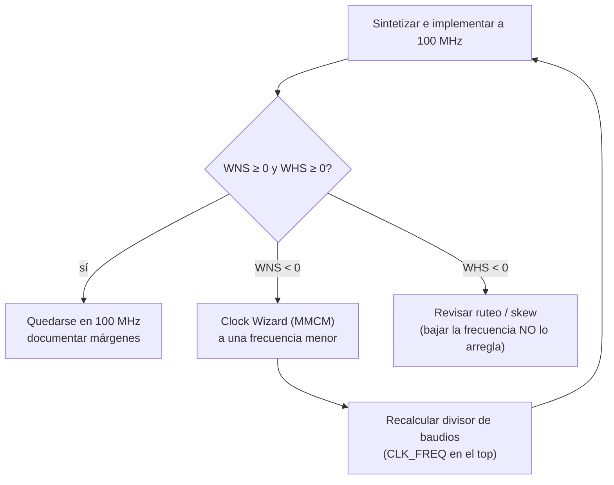

**`ADR-017` Cómo se serializan los registros de pipeline — falta decidir**

**El plan recomienda:** Campos de la etapa 6, en bytes enteros, orden fijo.

**Para nosotras:** Igual. Escribir el orden una sola vez.

El orden va en un solo documento y se implementa en Verilog y Python.

**`ADR-018` Accesos desalineados, endianness, instrucciones ilegales — igual**

**El plan recomienda:** Little-endian; se ignoran bits bajos; ilegal = NOP.

**Para nosotras:** Igual. Documentar.

Limitaciones declaradas en el informe.

**`ADR-019` Reutilizar la ALU del TP1 — distinto**

**El plan recomienda:** Reescribirla a 32 bits con códigos de 4 bits.

**Para nosotras:** Tu ALU es parametrizable: adaptarla (etapa 7).

Se agregan SLL, SLT y SLTU; se invierte el operando del desplazamiento.

**`ADR-020` Versión de Vivado — igual**

**El plan recomienda:** Fijar una sola.

**Para nosotras:** Hacerlo.

Evita proyectos que no abren entre versiones.

---

# Etapa 13 — El plan de trabajo

> **En una frase:** El plan del compañero son 6 hitos y 105 días de trabajo. Nosotras tenemos 3 semanas y unos 30 días entre las dos, así que hay que recortar.

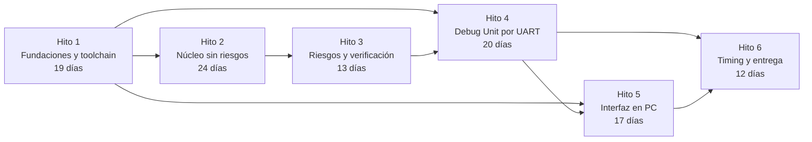

### Los 6 hitos del plan

**Hito 1 · Fundaciones y toolchain — 19 días**

Al terminar podés escribir un programa, ensamblarlo y saber qué debería dar, aunque no exista el procesador.

| US | Qué es | Días |
|---|---|---|
| 101 | Repositorio y proyecto de Vivado reproducible | 1–2 |
| 102 | Simulación con testbenches que dicen PASS/FAIL | 3 |
| 103 | Diagrama del datapath, tabla de control, interfaz del núcleo | 3 |
| 104 | Protocolo byte a byte | 1,5 |
| 105 | Tabla de instrucciones única | 1 |
| 106 | Ensamblador y desensamblador | 6 |
| 107 | Golden model | 3 |

**Hito 2 · Núcleo sin riesgos — 24 días**

El procesador ejecuta las 33 instrucciones en simulación, con NOPs a mano entre dependencias.

| US | Qué es | Días |
|---|---|---|
| 201 | ALU de 32 bits y control de ALU (tu TP1) | 3 |
| 202 | Banco de registros con bypass | 1,5 |
| 203 | Unidad de control e inmediatos | 3 |
| 204 | Memorias con acceso de byte y media palabra | 4 |
| 205 | Etapa IF y registro IF/ID | 2 |
| 206 | Etapa ID y registro ID/EX | 1,5 |
| 207 | Etapa EX y registro EX/MEM | 2 |
| 208 | Etapas MEM y WB | 1,5 |
| 209 | Integración, HALT y vaciado del pipeline | 5 |

**Hito 3 · Riesgos y verificación — 13 días**

El procesador ejecuta cualquier programa sin NOPs a mano y una suite lo demuestra contra el golden model.

| US | Qué es | Días |
|---|---|---|
| 301 | Forwarding | 3 |
| 302 | Load-use y stall | 2 |
| 303 | Flush en saltos y HALT especulativo | 3 |
| 304 | Suite de programas de prueba | 3 |
| 305 | Verificación cruzada automática y CPI | 2 |

**Hito 4 · Debug Unit por UART — 20 días**

El procesador funciona en la placa, controlado desde la PC.

| US | Qué es | Días |
|---|---|---|
| 401 | Adaptar la UART del TP2 y armar el nuevo top | 1,5 |
| 402 | Intérprete de comandos (FSM) | 3 |
| 403 | Carga y reprogramación | 3 |
| 404 | Modos RUN y STEP | 3 |
| 405 | Volcado de registros, pipeline y memoria | 5 |
| 406 | Programas sin HALT y ABORT | 1,5 |
| 407 | Validación extremo a extremo en placa | 3 |

**Hito 5 · Interfaz en PC — 17 días**

Mínimo si falta tiempo: 501 a 504.

| US | Qué es | Días |
|---|---|---|
| 501 | Codec del protocolo y transportes | 2 |
| 502 | Sesión de depuración y CLI | 2 |
| 503 | Pantalla principal | 3 |
| 504 | Vista del pipeline | 5 |
| 505 | Registros y memoria con resaltado | 2 |
| 506 | Historial y verificación | 3 |

**Hito 6 · Timing y entrega — 12 días**

Responder las preguntas del reloj con datos de Vivado y cerrar el informe.

| US | Qué es | Días |
|---|---|---|
| 601 | Camino crítico y skew | 2 |
| 602 | Frecuencia óptima y Clock Wizard | 3 |
| 603 | Utilización, potencia y CPI | 1,5 |
| 604 | Informe final | 5 |
| 605 | Demostración y defensa | 1 |

### Qué recortaría (sugerencia)

- **Imprescindible:** diagrama y tabla de control · ALU, banco, control, memorias, 5 etapas, HALT · forwarding, load-use, flush · Debug Unit mínima (cargar, RUN, STEP, volcar) · prueba en placa · timing y frecuencia · informe.
- **Simplificar:** ensamblador chico en Python · golden model mínimo o firma de éxito · pocos programas de prueba · protocolo sin checksum · volcar toda la memoria de datos.
- **Dejar para el final:** interfaz gráfica · exportar sesiones · CHANGELOG, pull requests formales, cobertura 95% · ABORT con watchdog · manual.

### Cronograma de 3 semanas

Dos carriles en paralelo, núcleo y Debug Unit + PC, que se juntan en la semana 3. Lo que los une es el **contrato**.

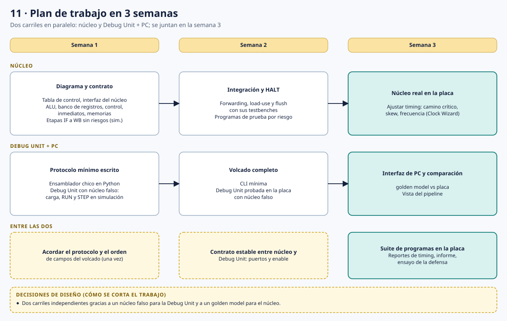

> **Importante:** Los tiempos son estimaciones. Lo firme: primero se fijan el **diagrama** y el **contrato** (puertos del núcleo y orden del volcado), porque de eso depende que las dos encajen.

---

# Etapa 14 — Lo que falta decidir

> **En una frase:** Hay cinco decisiones del protocolo abiertas, tres diferencias con el plan del compañero y seis preguntas para el profe.

### Decisiones abiertas (opción por defecto)

| Tema | Opción por defecto |
|---|---|
| Formato de carga | `'L'`, después N, después 4N bytes (palabras, byte bajo primero) |
| Tamaño de N | 1 byte si la memoria tiene hasta 255 palabras; 2 bytes si tiene 256 |
| Orden del volcado | fijo: encabezado, 32 registros, registros de pipeline, memoria |
| Baudios | empezar en 9600 (ya funciona) y subir a 115200 si el paso a paso se siente lento |
| Encabezado de 6 bytes | sí: `0xA5`, estado, ciclos. Ayuda a detectar desincronización |

**Propuesta de volcado con las opciones por defecto:**

```
┌──────┬────────┬──────────────┬──────────────────┬───────────────────┬──────────────────┐
│ 0xA5 │ estado │ ciclos (4 B) │ x0 … x31         │ IF/ID ID/EX       │ memoria de datos │
│ 1 B  │ 1 B    │ little-endian│ 32 × 4 B = 128 B │ EX/MEM MEM/WB     │ (usada o 1 KiB)  │
│      │        │              │                  │ orden fijo ADR-017│                  │
└──────┴────────┴──────────────┴──────────────────┴───────────────────┴──────────────────┘
 └──────── encabezado 6 B ─────┘
```

### Donde el plan no coincide con lo nuestro

- **HALT:** El plan propone `0x0000000B`. Nosotras acordamos con el profe `ebreak` = `0x00100073`. Mantener.
- **UART:** El plan asume 19200 con paridad. La tuya es 9600 sin paridad.
- **Plazo:** 12 semanas contra 3. No copiar el cronograma.

### Preguntas para el profe

1. Formato del informe y duración de la defensa.
2. Qué edición del libro es la referencia.
3. Qué es "memoria de datos usada": las palabras escritas o un rango.
4. "Terminar" en paso a paso: que el HALT llegue a WB.
5. Si alcanza un ensamblador propio simple.
6. Si se acepta la interfaz por línea de comandos.

### Errores de la consigna que detectó el plan

| Dice | Es |
|---|---|
| Tipo J: salta a la dirección guardada en rd | `rd` recibe PC+4. El destino es PC + inmediato. Saltar a un registro es `jalr`. |
| Branch rotula rs1 en dos campos | los bits [24:20] son rs2 |
| Ejemplo con `ld` | es de RV64. No se implementa. |
| "¿El camino crítico genera skew?" | No. El skew viene del reloj; sí afecta el margen del camino crítico. |

---

# Etapa 15 — Autoevaluación

> **En una frase:** Leé la pregunta, contestá en voz alta y después abrí la respuesta.

<details>
<summary>1. ¿Por qué enable y no clock gating?</summary>

Porque una compuerta en el reloj mete skew y pulsos falsos, y el enunciado lo prohíbe. El enable es el pin CE del flip-flop: el reloj llega intacto y el registro simplemente ignora el flanco.
</details>

<details>
<summary>2. ¿Qué es un STEP en términos de señales?</summary>

`enable` en 1 durante exactamente un ciclo de reloj. Si dura dos, el procesador avanza dos.
</details>

<details>
<summary>3. ¿Por qué un lw seguido de un add que usa el dato necesita un stall aunque haya forwarding?</summary>

El dato recién existe al final de MEM, demasiado tarde para el EX siguiente. Se frena un ciclo (burbuja en EX) y después se reenvía desde MEM/WB.
</details>

<details>
<summary>4. Si EX/MEM y MEM/WB escriben el mismo registro que se necesita, ¿cuál se reenvía?</summary>

EX/MEM, porque es el resultado más reciente.
</details>

<details>
<summary>5. ¿Por qué el forwarding nunca reenvía con destino x0?</summary>

Porque x0 vale siempre 0: una instrucción que "escribe" x0 no cambia nada, y reenviar su resultado daría un valor distinto de 0.
</details>

<details>
<summary>6. ¿Cuántos ciclos se pierden con un branch tomado y por qué?</summary>

Dos, porque se resuelve en EX y para entonces ya se buscaron las dos instrucciones siguientes, que se descartan (flush).
</details>

<details>
<summary>7. ¿Qué distingue una burbuja de un NOP?</summary>

El bit valid. Una burbuja tiene valid = 0 y nunca escribe registros ni memoria; un `addi x0,x0,0` es una instrucción real.
</details>

<details>
<summary>8. ¿Dónde se detecta el HALT y cuándo termina el programa?</summary>

Se detecta en ID: se deja de buscar y se descarta lo que vino detrás. El programa termina cuando el ebreak llega a WB, con el pipeline vacío.
</details>

<details>
<summary>9. ¿Por qué addi x1,x0,-1024 podría ejecutarse como sub?</summary>

Porque el bit 30 del inmediato vale 1, y en una R-type ese bit distingue add de sub. En I-type solo se mira si funct3 = 101.
</details>

<details>
<summary>10. ¿Qué te cambia usar BRAM para la memoria de instrucciones?</summary>

La lectura es sincrónica: la instrucción llega un ciclo después de pedir la dirección. Hay que alinear PC e instrucción y frenar el puerto de lectura con enable.
</details>

<details>
<summary>11. ¿Qué pasa si un programa no tiene HALT?</summary>

Sin protección, el PC da la vuelta y re-ejecuta memoria vieja; en RUN nunca termina. Por eso la IMEM se rellena con ebreak al cargar, y está el comando ABORT.
</details>

<details>
<summary>12. ¿Qué hay que limpiar al recargar un programa?</summary>

El pipeline (obligatorio, si no se terminan de ejecutar instrucciones viejas), los registros y la memoria de datos. La memoria de programa se rellena con HALT.
</details>

<details>
<summary>13. Si usás el Clock Wizard para bajar la frecuencia, ¿qué más tenés que cambiar?</summary>

`CLK_FREQ` en el top, para recalcular el divisor de baudios. Si no, la UART queda a otra velocidad y la PC no la entiende.
</details>

<details>
<summary>14. ¿El camino crítico genera skew?</summary>

No. El skew viene de la red de reloj. Lo que sí hace es cambiar el margen (slack) del camino crítico.
</details>

<details>
<summary>15. ¿Cómo sabés que el procesador está bien?</summary>

Corriendo el mismo programa en el golden model y en la placa (RUN y STEP): si registros y memoria coinciden, está bien. Plan B: firma de éxito en memoria.
</details>

---

# Diccionario

### $readmemh

Tarea de simulación que llena una memoria con un archivo de texto hexadecimal.

**En el TP:** Se usa para precargar el programa en un testbench.

### ACK / NACK

Respuesta de "recibido y entendido" / "rechazado" con un código de error.

**En el TP:** Todo comando recibe una respuesta.

### ADR

Architecture Decision Record: una hoja con una decisión de diseño, su contexto, las alternativas y las consecuencias.

**Analogía:** El cuaderno de obra del arquitecto.

**En el TP:** El informe pide explicar las decisiones y sus porqués.

### ALU

Unidad aritmético-lógica: calcula sumas, restas, comparaciones, lógicas y desplazamientos.

**Analogía:** La calculadora del procesador.

**En el TP:** Tu TP1. Ahora a 32 bits y con SLL, SLT, SLTU.

### Banco de registros

32 registros de 32 bits, 2 lecturas y 1 escritura por ciclo.

**En el TP:** x0 vale siempre 0.

### Baud rate

Cantidad de bits por segundo en la línea serie.

**Analogía:** La velocidad a la que habla alguien.

**En el TP:** 9600 en tu TP2. Si PC y placa no coinciden, no se entienden.

### Bit

La unidad mínima de información: un 0 o un 1.

**Analogía:** Un interruptor: prendido o apagado.

**En el TP:** Cada cable de una señal del procesador lleva un bit.

### Bit valid

Bit extra en cada registro de pipeline: "esto es una instrucción real".

**En el TP:** Distingue una burbuja de un addi x0,x0,0 de verdad. Con los 4 valid en 0, el pipeline está vacío.

### Bitmap de memoria usada

Un bit por palabra de memoria, que se pone en 1 cuando el programa la escribe.

**Analogía:** Una lista donde tildás cada casillero que usaste.

**En el TP:** Al volcar se envían solo las palabras marcadas.

### BRAM

Bloques de RAM dedicados de la FPGA. Lectura sincrónica: el dato sale un ciclo después de la dirección. Sin reset.

**Analogía:** Un casillero con secretaria: pedís y te lo traen en el próximo turno.

**En el TP:** La IMEM y la DMEM se infieren como BRAM.

### Burbuja

Un hueco en el pipeline: una etapa sin instrucción real este ciclo.

**Analogía:** Una estación vacía en la línea de armado.

**En el TP:** Se implementa con valid=0 y las señales de escritura apagadas.

### Bypass interno del banco

Si WB escribe un registro que ID lee en el mismo ciclo, la lectura devuelve el dato nuevo.

**En el TP:** Evita un riesgo estructural sin tocar el reloj.

### Byte

8 bits juntos. Puede valer de 0 a 255 (0x00 a 0xFF).

**Analogía:** Una letra del teclado ocupa un byte.

**En el TP:** Lo que viaja por la UART es de a un byte por vez.

### Byte enable

Un bit por byte de la palabra para escribir solo algunos bytes.

**En el TP:** Permite sb y sh sin pisar el resto de la palabra.

### Camino crítico

El camino registro→lógica→registro de mayor retardo. Define la frecuencia máxima.

**Analogía:** El tramo más lento de una carrera de postas.

**En el TP:** No es lo mismo que el skew.

### Checksum

Número calculado sobre los bytes y enviado al final para detectar corrupción. Aquí: XOR de todos los bytes.

**Analogía:** El dígito verificador de un documento.

**En el TP:** 0x12 xor 0x34 xor 0x56 = 0x70.

### CLI / TUI / GUI

Interfaz de línea de comandos / de texto con colores / gráfica.

**En el TP:** CLI primero; lo gráfico solo si sobra tiempo.

### Clock gating

Apagar el reloj con una compuerta. Genera skew y pulsos falsos.

**Analogía:** Cortarle la luz al metrónomo con la mano: puede quedar un golpe a medias.

**En el TP:** Prohibido por el enunciado.

### Combinacional

Lógica sin memoria: la salida depende solo de las entradas de ahora.

**Analogía:** Una calculadora: apretás y sale el resultado.

**En el TP:** La ALU, los mux, imm_gen, la unidad de control.

### Contrato

Interfaz fijada antes de repartirse el trabajo: puertos, campos y bytes.

**Analogía:** Los planos que las dos partes acuerdan antes de construir.

**En el TP:** US-103 y US-104.

### CPI

Ciclos por instrucción. Ideal = 1. Los stalls y flushes lo suben.

**En el TP:** Tiempo = instrucciones × CPI × período.

### Criterios de aceptación (AC)

Pruebas concretas que definen "terminado" para una tarea.

**Analogía:** Los puntos del examen que tenés que aprobar.

**En el TP:** Cada AC es una línea de testbench.

### Desensamblador

El camino inverso: de una palabra a su texto.

**En el TP:** Para mostrar qué instrucción hay en cada etapa.

### DMEM

Memoria de datos. La usan load y store.

**En el TP:** La Debug Unit la lee para el volcado.

### DoD

Definition of Done: la lista que toda tarea debe cumplir para darse por terminada.

**En el TP:** Para 3 semanas importan: testbench, sin latches inferidos, reloj intacto, contratos actualizados.

### Dos pasadas

1.ª: asignar direcciones y anotar las etiquetas. 2.ª: calcular los saltos y codificar.

**Analogía:** Primero leés el índice, después armás el resumen.

**En el TP:** Necesario porque un salto puede apuntar a una etiqueta que todavía no apareció.

### Dual port

Memoria con dos accesos independientes a la vez.

**Analogía:** Dos ventanillas.

**En el TP:** Uno para el procesador y otro para la Debug Unit.

### DUT

Device Under Test: el módulo que estás probando.

**En el TP:** En alu_tb es la alu.

### Enable / Clock enable

Señal que decide si un flip-flop le hace caso al flanco. Con enable=0 mantiene su valor aunque el reloj siga latiendo.

**Analogía:** Un interruptor de "grabar" en una cámara que siempre está encendida.

**En el TP:** Así se pausa y se da un paso del procesador sin tocar el reloj.

### Ensamblador

Convierte assembly (texto) en código máquina (palabras de 32 bits).

**Analogía:** Un traductor.

**En el TP:** Propio, en Python.

### Épica

Grupo de tareas del mismo tema dentro de un hito.

**En el TP:** Ej.: "Unidades de riesgo".

### Extensión de signo

Pasar un número de pocos bits a 32 sin cambiar su valor: se copia el bit de signo hacia la izquierda.

**Analogía:** Completar con 9 a la izquierda en -4 = ...9996 (si fuera decimal).

**En el TP:** 12 bits 1111 1111 1100 (-4) pasan a 0xFFFFFFFC.

### Fake

Lo mismo que un stub, del lado de Python: simula la placa.

**En el TP:** FakeTransport usa el golden model.

### Fan-out

Cuántos destinos alimenta una señal.

**Analogía:** Un grifo que riega 300 canteros.

**En el TP:** enable llega a cientos de flip-flops y puede entrar al camino crítico.

### Firma de éxito

Un valor fijo que un programa de prueba escribe en una dirección fija si todo salió bien.

**En el TP:** Permite autoverificar sin golden model.

### Flip-flop

Guarda 1 bit. Toma su entrada solo en el flanco de subida del reloj.

**Analogía:** Una cámara que saca una foto en cada "clic" del metrónomo.

**En el TP:** Tiene un pin CE (clock enable): si está en 0 ignora el flanco.

### Flush

Descartar instrucciones buscadas por error (después de un salto tomado). Se pone valid=0 y se apagan sus escrituras.

**Analogía:** Tirar los platos que ya preparaste para una mesa que cambió de pedido.

**En el TP:** Salto tomado: se pierden 2 ciclos. Gana sobre el stall.

### Forwarding (bypass)

Llevar un resultado desde EX/MEM o MEM/WB directo a la entrada de la ALU, sin esperar a que se escriba en el banco de registros.

**Analogía:** Pasarle la receta al cocinero por la ventanilla en vez de archivarla primero.

**En el TP:** Dos mux de 3 entradas delante de la ALU. Gana EX/MEM si coinciden. Nunca con destino x0.

### FSM (máquina de estados)

Un registro de estado y reglas "si estoy en X y pasa Y, voy a Z".

**Analogía:** Un semáforo.

**En el TP:** La Debug Unit es una FSM grande.

### FSMD

FSM + datapath (contadores y registros de datos) en el mismo módulo.

**Analogía:** El cerebro y las manos juntos.

**En el TP:** Tu uart_rx y tu interface_alu son FSMD.

### funct3 / funct7

Campos que, junto con el opcode, eligen la operación exacta (add vs sub, lb vs lw).

**Analogía:** El sub-rubro dentro del rubro.

**En el TP:** alu_control los usa para elegir la operación de la ALU.

### Git: rama y pull request

Rama = línea de trabajo paralela. Pull request = pedir que tus cambios se incorporen, con revisión.

**En el TP:** Para 3 semanas alcanza con commits claros y una rama simple.

### Golden model / ISS

Simulador de software, sin pipeline, que ejecuta el programa instrucción por instrucción. Da el resultado esperado.

**Analogía:** La respuesta al final del libro.

**En el TP:** Si la placa y el modelo difieren en registros o memoria, hay un bug.

### HALT / ebreak

Instrucción que detiene el procesador. No existe en RV32I; usamos ebreak (0x00100073), acordado con el profe.

**Analogía:** El cartel de "fin" de una película.

**En el TP:** Se detecta en ID, se deja de buscar, el pipeline se vacía y al llegar a WB termina.

### Handshake

Protocolo mínimo para pasarse un dato sin perderlo: uno avisa "tengo", el otro avisa "listo".

**Analogía:** Pasar un paquete de mano en mano diciendo "tomá" y "lo tengo".

**En el TP:** tx_start / tx_done_tick, rx_done_tick.

### Historia de usuario (US)

Una tarea con quién la quiere, para qué y cómo se sabe que está lista.

**En el TP:** US-301 = forwarding.

### Hito

Etapa del proyecto que termina en algo demostrable.

**En el TP:** El plan tiene 6 hitos.

### IMEM

Memoria de instrucciones (el programa). La escribe la Debug Unit y la lee IF.

**En el TP:** Se rellena con HALT al cargar.

### Inmediato

Un número que viene escrito dentro de la propia instrucción (en addi x1,x2,10 es el 10).

**Analogía:** El número de la receta, no del frasco.

**En el TP:** En S, B y J está partido y reordenado en la palabra. imm_gen lo vuelve a armar.

### Instrucción especulativa

Instrucción buscada apostando a que el salto no se toma. Si se equivocó, se descarta.

**En el TP:** Un HALT detrás de un branch tomado también es especulativo: se descarta.

### ISA

Instruction Set Architecture: el contrato entre software y hardware. Qué instrucciones existen y qué hacen.

**Analogía:** El menú de un restaurante: define qué se puede pedir.

**En el TP:** Usamos un subconjunto de RISC-V.

### Latch

Tiene tres sentidos. (1) Circuito real sensible a nivel. (2) Nombre informal del enunciado para los registros de pipeline. (3) Error de síntesis: un latch inferido por no asignar una salida en todos los caminos.

**En el TP:** Evitá el (3) con valores por defecto al inicio del always @(*), como en TP1 y TP2.

### Little-endian

Orden de bytes donde el menos significativo va en la dirección más baja. 0x11223344 se guarda como 44 33 22 11.

**Analogía:** Escribir una fecha empezando por el día: lo "chico" primero.

**En el TP:** RISC-V es little-endian. Por eso las palabras viajan por UART empezando por el byte bajo.

### Load-use

Un lw seguido de una instrucción que usa el dato cargado. El dato recién existe al final de MEM, demasiado tarde para el EX siguiente.

**Analogía:** Pedir un plato y querer comerlo antes de que salga de la cocina.

**En el TP:** 1 ciclo de stall + forwarding desde MEM/WB.

### LUTRAM

Memoria hecha con LUTs (tablas de verdad). Lectura inmediata. Gasta lógica.

**En el TP:** Sirve solo para memorias chicas.

### Makefile

Archivo de recetas: "make sim" corre una simulación, "make build" sintetiza.

**En el TP:** Un comando por tarea repetitiva.

### Metaestabilidad

Si una señal externa cambia justo en el flanco, el flip-flop puede quedar un rato en un valor indefinido.

**Analogía:** Una moneda que quedó parada de canto.

**En el TP:** El sincronizador de 2 flip-flops de uart_rx lo evita.

### MMCM / Clock Wizard

Bloque dedicado que genera otras frecuencias a partir de los 100 MHz. Su pin locked avisa cuando es estable.

**En el TP:** Usarlo no es intervenir el clock.

### NFR

Requisito no funcional: qué tan bien funciona (timing, latencia, robustez), no qué hace.

**En el TP:** WNS ≥ 0, un paso en menos de 1 s.

### NOP

Instrucción que no hace nada. En RISC-V es addi x0,x0,0 (0x00000013).

**En el TP:** Se usa para rellenar espacios; la burbuja la distingue el bit valid.

### North Star

La métrica principal del proyecto.

**En el TP:** 100% de los programas de prueba correctos en la placa.

### Opcode

Los 7 bits bajos de una instrucción. Dicen de qué familia es (suma de registros, load, salto…).

**Analogía:** El rubro de un comercio: define qué tipo de cosa es.

**En el TP:** El control principal mira solo el opcode para decidir las señales de control.

### Palabra (word)

En RISC-V de 32 bits, una palabra son 32 bits = 4 bytes.

**Analogía:** Un renglón de 4 casilleros.

**En el TP:** Un registro guarda una palabra. Cada instrucción es una palabra.

### PC (program counter)

Registro que guarda la dirección de la instrucción que se va a buscar.

**Analogía:** El dedo que va siguiendo un renglón.

**En el TP:** Se reinicia en 0 y suma 4 cada ciclo, salvo saltos, stalls o enable=0.

### Pipeline (segmentación)

Partir la ejecución en etapas para que varias instrucciones avancen a la vez.

**Analogía:** Una línea de armado de autos.

**En el TP:** 5 etapas: IF, ID, EX, MEM, WB. Hasta 5 instrucciones en vuelo.

### Registro

Varios flip-flops con el mismo reloj, guardando una palabra.

**Analogía:** Una casilla donde se guarda un número.

**En el TP:** El PC y los registros de pipeline son de este tipo.

### Registro de segmentación

Banco de flip-flops entre dos etapas. Guarda datos y señales de control de una instrucción.

**Analogía:** La bandeja donde se deja el trabajo para la siguiente estación.

**En el TP:** IF/ID, ID/EX, EX/MEM, MEM/WB. El enunciado los llama "latches".

### Reloj (clock)

Señal que alterna 0 y 1 con regularidad. Cada flanco de subida es un "latido" donde los flip-flops toman nota.

**Analogía:** El metrónomo de una banda.

**En el TP:** 100 MHz en la Basys 3: un latido cada 10 ns.

### Riesgo (hazard)

Situación en la que la instrucción siguiente no puede ejecutarse bien en el ciclo que le toca. Hay de datos, de control y estructurales.

**En el TP:** Se resuelven con forwarding, stall, flush y memorias separadas.

### RISC-V / RV32I

Familia abierta de instrucciones. RV32I = la base de 32 bits con enteros (sin multiplicación).

**En el TP:** Implementamos 32 instrucciones de RV32I + una para parar.

### Skew

Diferencia de llegada del mismo flanco de reloj a dos flip-flops.

**Analogía:** Dos relojes que no marcan exactamente igual.

**En el TP:** Lo causan la red de reloj y cualquier lógica metida en ella. Cambia el margen del camino crítico.

### Slack

Tiempo que sobra en un camino. Positivo: llega a tiempo. Negativo: llega tarde.

**En el TP:** slack = T − (t_cq + lógica + ruteo + setup) ± skew.

### Snapshot

Foto del estado completo del procesador en un mismo ciclo. Se toma con el núcleo congelado.

**En el TP:** PC, 32 registros, registros de pipeline y memoria usada.

### Sobremuestreo x16

Se mira cada bit 16 veces para tomar la muestra en el medio.

**Analogía:** Sacar la foto en el centro del bit.

**En el TP:** El s_tick de tu baudio_generator.

### Stall

Frenar las etapas tempranas un ciclo y meter una burbuja en EX.

**Analogía:** Esperar en la fila.

**En el TP:** Solo hace falta en load-use.

### Stub

Módulo falso con los mismos puertos que el real, para probar sin él.

**Analogía:** Un maniquí.

**En el TP:** core_stub.v para probar la Debug Unit antes de tener el procesador.

### Testbench

Módulo de simulación que genera entradas y mira las salidas del módulo bajo prueba (DUT). No se sintetiza.

**Analogía:** Un banco de pruebas de laboratorio.

**En el TP:** Tu alu_tb. Autoverificable = dice solo PASSED o FAILED.

### Tick / pulso

Una señal que vale 1 durante un solo ciclo de reloj. Es un evento.

**Analogía:** Un timbre.

**En el TP:** s_tick, rx_done_tick, tx_done_tick.

### Timeout

Si pasa demasiado tiempo sin recibir lo esperado, se abandona y se vuelve a un estado seguro.

**En el TP:** Ya lo usaste en interface_alu (0,5 s).

### Trama

Mensaje con estructura: cabecera, tipo, longitud, datos, checksum.

**Analogía:** Un sobre con remitente y contenido.

**En el TP:** Las respuestas de la FPGA empiezan con 0xA5.

### UART

Comunicación serie asincrónica: manda un byte como una secuencia de pulsos, uno por vez.

**Analogía:** Hablar por teléfono: una palabra detrás de otra, sin reloj compartido.

**En el TP:** Tu TP2: baudio_generator, uart_rx, uart_tx.

### Volcado (dump)

Enviar el snapshot por UART.

**En el TP:** A 9600 baud tarda unos 0,2 a 0,5 s.

### WNS / WHS

Peor slack de setup / de hold de todo el diseño. Si ambos son ≥ 0, cumple timing.

**En el TP:** Bajar la frecuencia arregla el setup, no el hold.

### x0

El registro 0. Siempre vale 0; escribirlo no hace nada.

**En el TP:** El forwarding nunca debe reenviar con destino x0.

### XDC (constraints)

Archivo que dice a Vivado qué pin es cada puerto y cuál es el período del reloj.

**En el TP:** Sin el reloj declarado no hay análisis de timing.

---

# Apéndice A — Qué lleva cada registro de segmentación

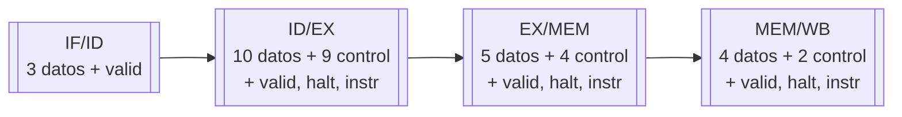

## IF/ID

Lo que sale de buscar la instrucción.

**Datos:**
- `pc`: dirección de esa instrucción
- `pc_plus4`: dirección de la siguiente (PC+4); la usa jal/jalr
- `instr`: la palabra de 32 bits

**Control:**
- (ninguno todavía)

**Depuración:**
- `valid`: 1 = instrucción real, 0 = burbuja

## ID/EX

El más cargado: operandos, inmediato, números de registro y todo el control.

**Datos:**
- `pc`: dirección de esa instrucción
- `pc_plus4`: dirección de la siguiente (PC+4); la usa jal/jalr
- `rs1_data`: valor leído del registro rs1
- `rs2_data`: valor leído del registro rs2
- `imm`: inmediato ya armado y extendido
- `rs1`: número de registro fuente 1 (para el forwarding)
- `rs2`: número de registro fuente 2
- `rd`: número del registro destino
- `funct3`: campo funct3
- `funct7_b5`: bit 30: add/sub, srl/sra

**Control:**
- `reg_write`: ¿escribe un registro?
- `mem_read`: ¿lee memoria?
- `mem_write`: ¿escribe memoria?
- `result_src`: qué se escribe: ALU, memoria o PC+4
- `alu_src`: segundo operando: registro o inmediato
- `alu_op`: 2 bits para alu_control
- `branch`: es un branch
- `jump`: es jal
- `jalr`: es jalr

**Depuración:**
- `valid`: 1 = instrucción real, 0 = burbuja
- `halt`: esta instrucción es el ebreak
- `instr`: la palabra de 32 bits

## EX/MEM

Lo que sale de la ALU. De acá sale el forwarding más reciente.

**Datos:**
- `alu_result`: resultado de la ALU (o la dirección de memoria)
- `store_data`: rs2 ya con forwarding: lo que guarda un store
- `rd`: número del registro destino
- `pc_plus4`: dirección de la siguiente (PC+4); la usa jal/jalr
- `funct3`: campo funct3

**Control:**
- `reg_write`: ¿escribe un registro?
- `mem_read`: ¿lee memoria?
- `mem_write`: ¿escribe memoria?
- `result_src`: qué se escribe: ALU, memoria o PC+4

**Depuración:**
- `valid`: 1 = instrucción real, 0 = burbuja
- `halt`: esta instrucción es el ebreak
- `instr`: la palabra de 32 bits

## MEM/WB

Lo último antes de escribir el registro destino.

**Datos:**
- `alu_result`: resultado de la ALU (o la dirección de memoria)
- `mem_data`: dato leído de memoria, ya extendido con signo o cero
- `pc_plus4`: dirección de la siguiente (PC+4); la usa jal/jalr
- `rd`: número del registro destino

**Control:**
- `reg_write`: ¿escribe un registro?
- `result_src`: qué se escribe: ALU, memoria o PC+4

**Depuración:**
- `valid`: 1 = instrucción real, 0 = burbuja
- `halt`: esta instrucción es el ebreak
- `instr`: la palabra de 32 bits

---

# Apéndice B — Formatos de instrucción RV32I

Todas las instrucciones miden 32 bits. Los bits se numeran de 31 (izquierda) a 0.

| Tipo | 31–25 | 24–20 | 19–15 | 14–12 | 11–7 | 6–0 | Ejemplos |
|---|---|---|---|---|---|---|---|
| R | funct7 | rs2 | rs1 | funct3 | rd | opcode | add, sub, and, or, xor, sll, srl, sra, slt, sltu |
| I | imm[11:0] | | rs1 | funct3 | rd | opcode | addi, andi, ori, xori, slti, lw, jalr |
| S | imm[11:5] | rs2 | rs1 | funct3 | imm[4:0] | opcode | sw, sh, sb |
| B | imm[12\|10:5] | rs2 | rs1 | funct3 | imm[4:1\|11] | opcode | beq, bne, blt, bge |
| U | imm[31:12] | | | | rd | opcode | lui, auipc |
| J | imm[20\|10:1\|11\|19:12] | | | | rd | opcode | jal |

```
         31    25 24  20 19  15 14 12 11   7 6     0
 R  │  funct7  │ rs2  │ rs1  │ f3  │  rd   │opcode │
 I  │     imm[11:0]   │ rs1  │ f3  │  rd   │opcode │
 S  │imm[11:5] │ rs2  │ rs1  │ f3  │imm[4:0]│opcode│
 B  │i[12|10:5]│ rs2  │ rs1  │ f3  │i[4:1|11]│opcode│
 U  │          imm[31:12]          │  rd   │opcode │
 J  │   imm[20|10:1|11|19:12]      │  rd   │opcode │
```

**Trampa del inmediato:** en S y B el inmediato viene partido en dos pedazos; el ensamblador y el generador de inmediatos tienen que armarlo igual.

**Trampa del bit 30:** en R-type distingue add de sub. En I-type es parte del número: solo se mira si funct3 = 101 (srli/srai). Si no, `addi x1,x0,-1024` se ejecutaría como `sub`.

**Little-endian:** una palabra de 32 bits se manda por la UART con el byte bajo primero. En la Debug Unit: `word <= {dout, word[31:8]}`.

**ALU (control en dos niveles):** `alu_op` de 2 bits: 00 sumar (loads, stores, jalr), 01 restar (beq, bne), 10 R-type (mirar funct3 y funct7), 11 I aritmético (mirar funct3). Después `alu_control` elige la operación de 4 bits.

---

# Apéndice C — Debug Unit y protocolo

**Estados:** IDLE, L_COUNT, L_WORD, RUN, STEP, DUMP. El diagrama de estados está en la [etapa 9](#etapa-9--la-debug-unit).

| Desde | Evento | Hacia | Qué pasa |
|---|---|---|---|
| IDLE | `L` (0x4C) | L_COUNT | empieza la carga |
| L_COUNT | llega N | L_WORD | cantidad de palabras |
| L_WORD | llegan 4N bytes | IDLE | carga completa, responde ACK, limpia el procesador |
| IDLE | `R` (0x52) | RUN | enable sostenido en 1 |
| RUN | ebreak llega a WB | DUMP | procesador congelado, pipeline vacío |
| IDLE | `S` (0x53) | STEP | enable en 1 durante un solo ciclo |
| STEP | pasó 1 ciclo | DUMP | se manda la foto |
| IDLE | `D` (0x44) | DUMP | volcado del estado |
| DUMP | terminó de enviar | IDLE | listo para otro comando |
| cualquiera de carga | timeout | IDLE | carga cortada, se descarta |

Un evento que no corresponde al estado actual se rechaza con NACK y no cambia el estado.

### Ejemplo: cargar un programa de 2 palabras

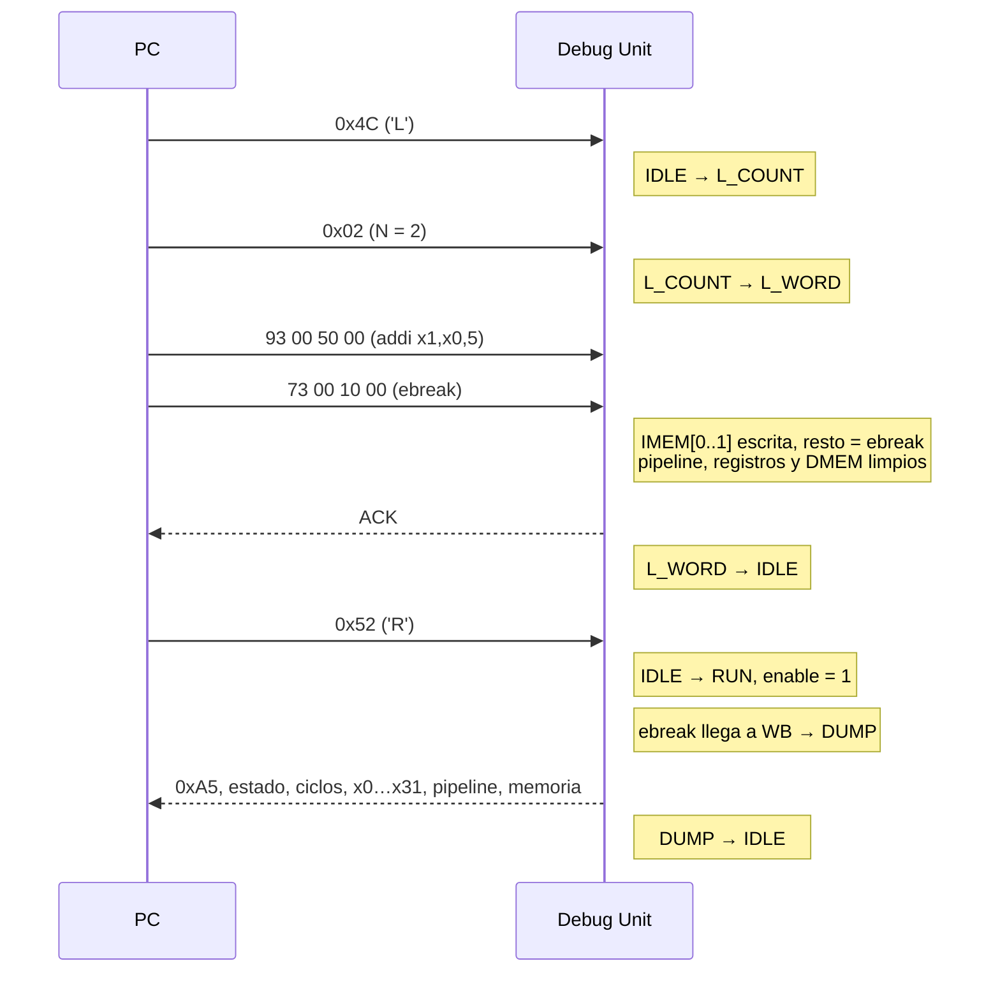

**Preguntas abiertas del protocolo (decidir):** formato y tamaño de N, orden del volcado, baudrate, cabecera de 6 bytes.
