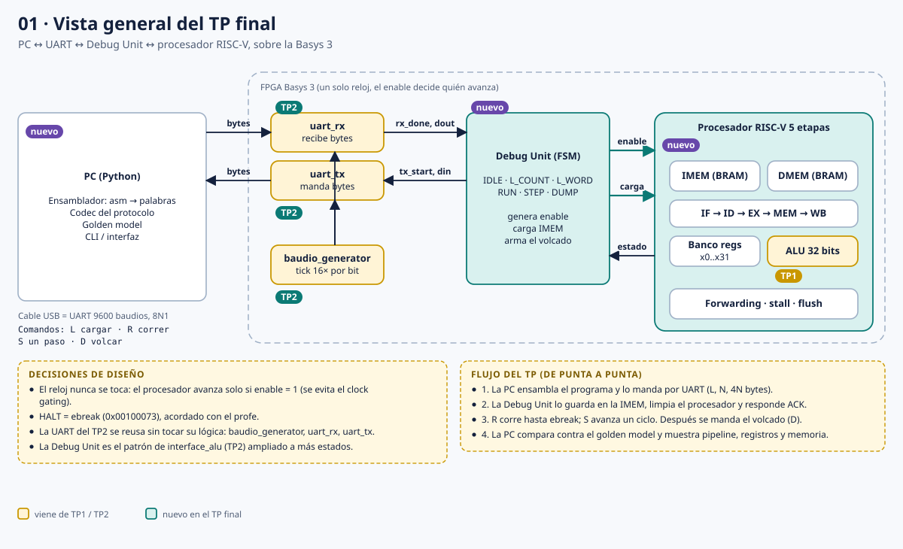
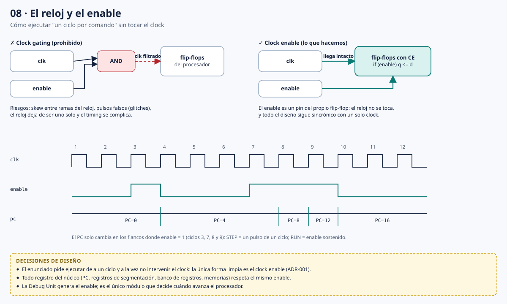
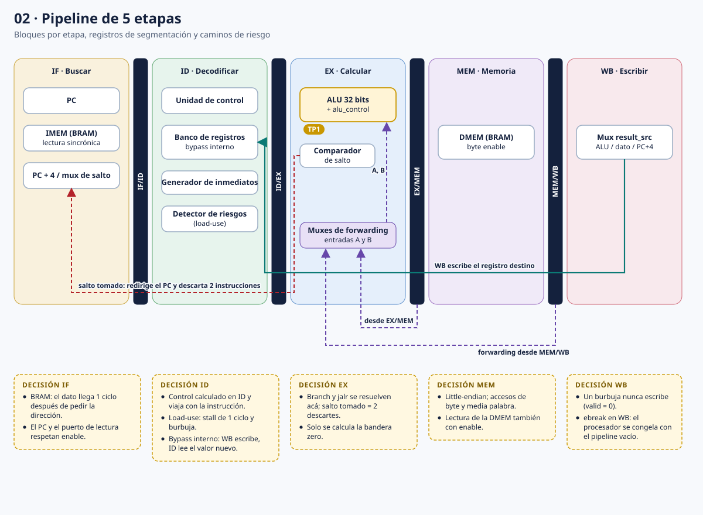
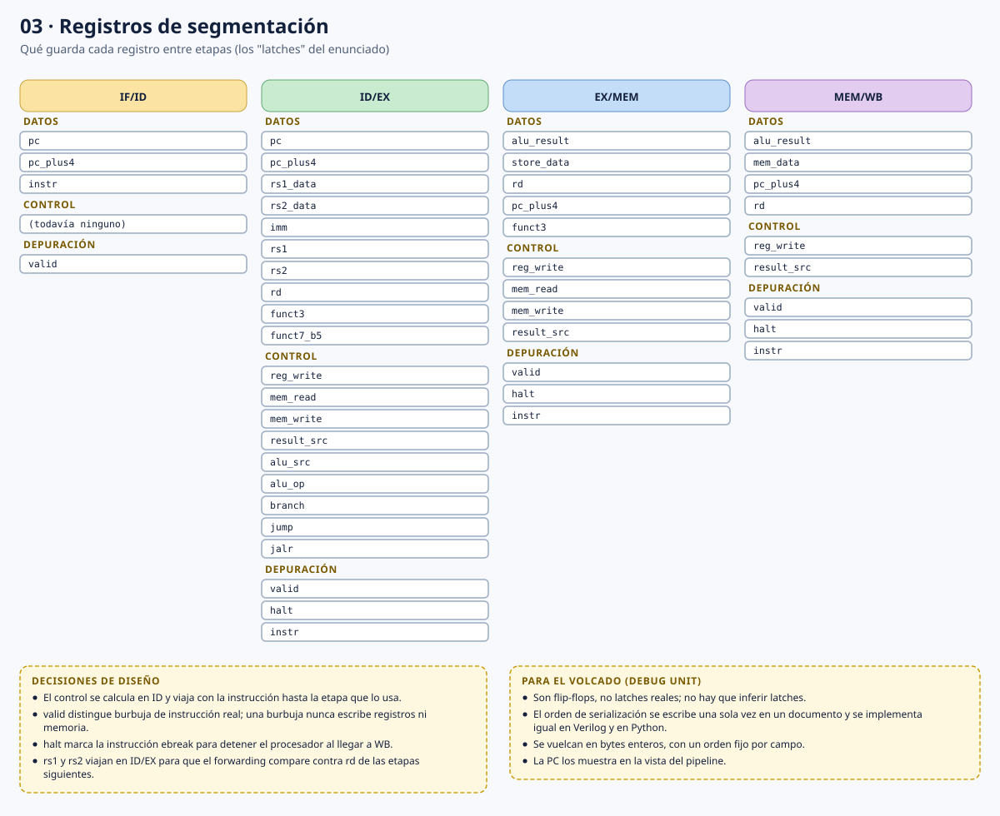
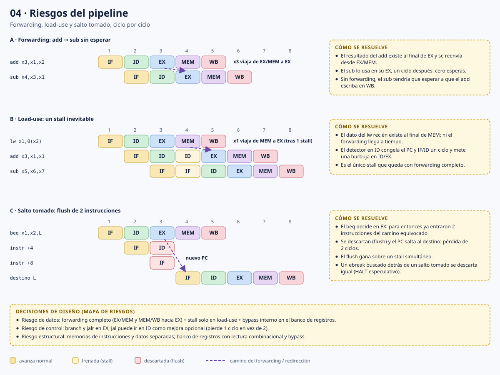
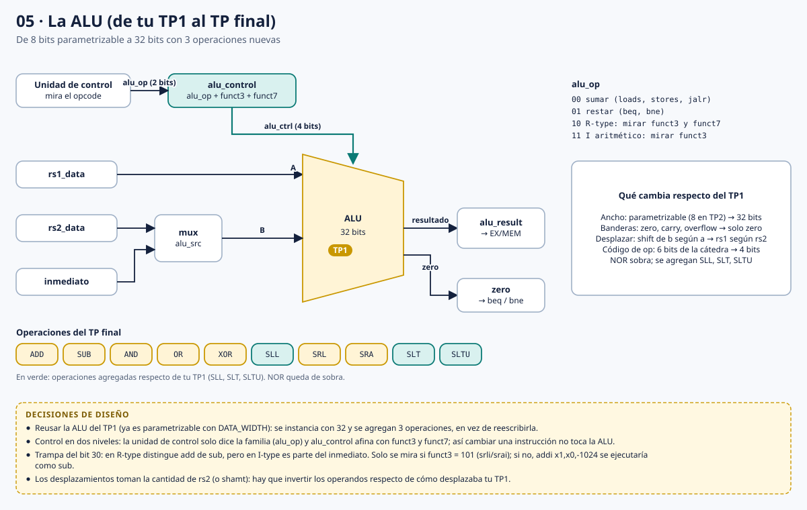
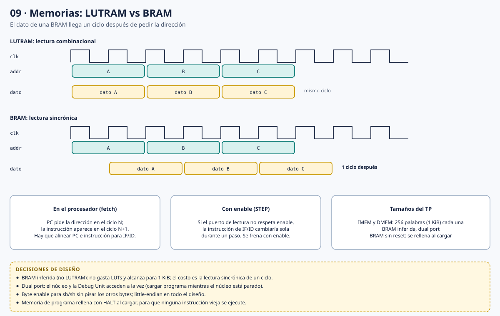
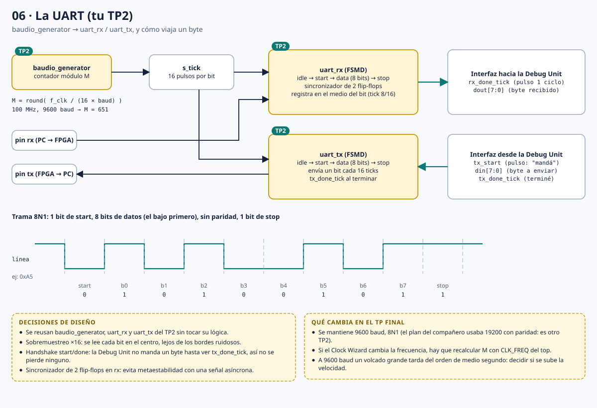
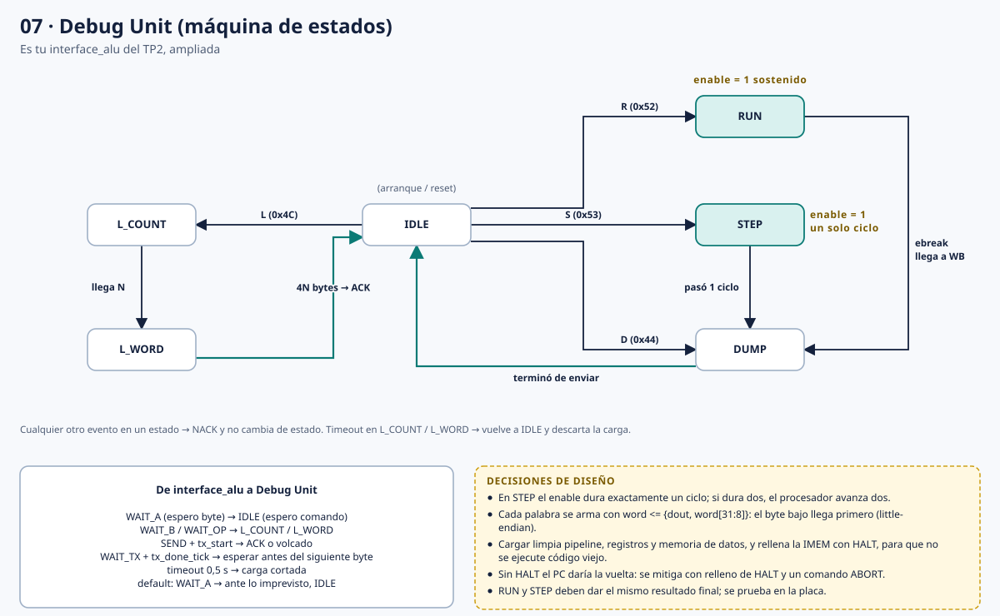
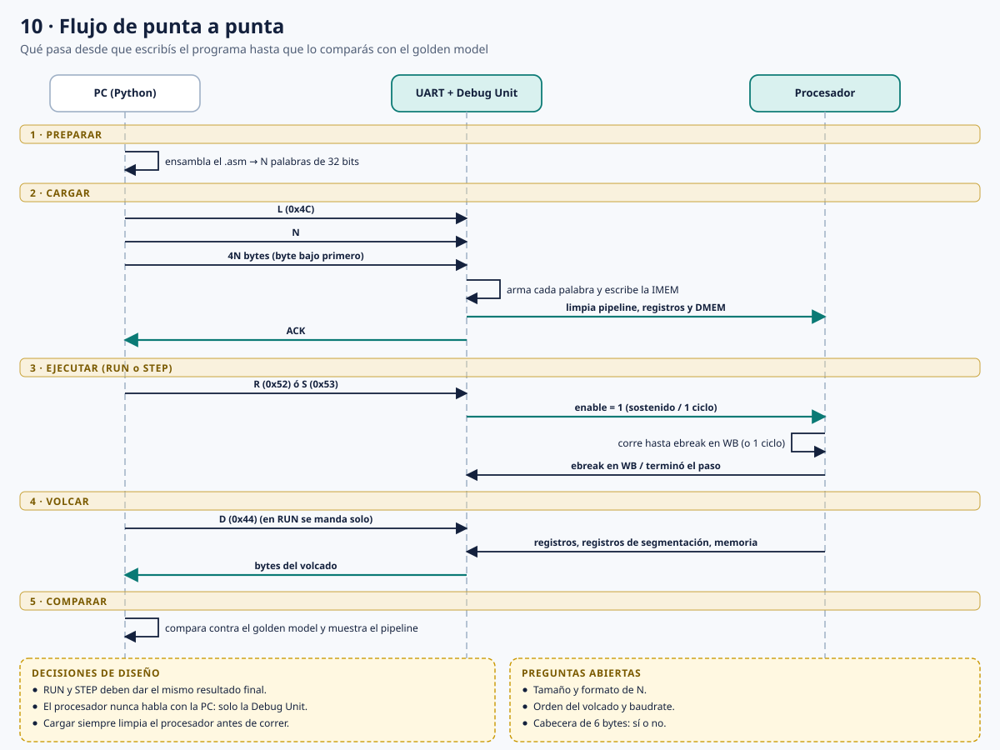

# TP Final — Procesador RISC-V de 5 etapas con Debug Unit por UART

Documentación de diseño. Cada sección explica un bloque, muestra su diagrama y resume las decisiones tomadas.

Para el marco teórico, las tablas ciclo a ciclo, las ADR completas y el diccionario, ver la [Guía de estudio](GUIA_DE_ESTUDIO.md).

## Índice

1. [Vista general](#1-vista-general)
2. [Reloj y enable](#2-reloj-y-enable)
3. [Pipeline de 5 etapas](#3-pipeline-de-5-etapas)
4. [Registros de segmentación](#4-registros-de-segmentación)
5. [Riesgos del pipeline](#5-riesgos-del-pipeline)
6. [ALU](#6-alu)
7. [Memorias](#7-memorias)
8. [UART](#8-uart)
9. [Debug Unit](#9-debug-unit)
10. [Flujo de punta a punta](#10-flujo-de-punta-a-punta)
11. [Decisiones abiertas](#11-decisiones-abiertas)
12. [Plan de trabajo](#12-plan-de-trabajo)

Convención de colores en los diagramas: amarillo = viene de TP1/TP2, verde = nuevo en el TP final.

---

## 1. Vista general

El sistema son dos mundos conectados por la UART de la Basys 3: el software de PC (ensamblador, codec del protocolo, golden model, interfaz) y la FPGA, que contiene la UART del TP2, la Debug Unit y el procesador RISC-V.

**Decisiones**
- El reloj nunca se toca: el procesador avanza solo si `enable = 1`.
- HALT = `ebreak` (`0x00100073`), acordado con el profesor.
- Se reutilizan `baudio_generator`, `uart_rx` y `uart_tx` del TP2 sin cambiar su lógica.
- La Debug Unit es el patrón de `interface_alu` (TP2) ampliado a más estados.

---

## 2. Reloj y enable

El enunciado pide ejecutar de a un ciclo y a la vez prohíbe intervenir el clock. La solución es el clock enable: el reloj llega intacto a todos los flip-flops y un pin `enable` decide si capturan o ignoran cada flanco.

**Decisiones**
- Clock enable en lugar de clock gating, que introduce skew y pulsos falsos.
- Todo registro del núcleo (PC, registros de segmentación, banco de registros, memorias) respeta el mismo `enable`.
- Solo la Debug Unit genera el `enable`.
- En STEP el `enable` dura exactamente un ciclo; en RUN es sostenido.

---

## 3. Pipeline de 5 etapas

IF, ID, EX, MEM y WB, separadas por cuatro registros de segmentación. El diagrama muestra los bloques de cada etapa, los caminos de forwarding, la redirección de salto y la escritura de WB al banco de registros.

**Decisiones**
- **IF:** la memoria de instrucciones es una BRAM; el dato llega un ciclo después de pedir la dirección.
- **ID:** el control se calcula acá y viaja con la instrucción. El banco de registros tiene bypass interno.
- **EX:** branch y jalr se resuelven acá. Solo se calcula la bandera `zero`.
- **MEM:** little-endian, con accesos de byte y media palabra.
- **WB:** una burbuja nunca escribe (`valid = 0`). Con `ebreak` en WB el procesador se congela con el pipeline vacío.

---

## 4. Registros de segmentación

Los "latches" del enunciado son bancos de flip-flops entre etapas, no latches reales. Cada uno guarda datos, señales de control y campos de depuración.

**Decisiones**
- El control se calcula en ID y acompaña a la instrucción hasta la etapa que lo usa.
- `valid` distingue una burbuja de una instrucción real.
- `halt` marca el `ebreak` para detener el procesador al llegar a WB.
- `rs1` y `rs2` viajan en ID/EX para que el forwarding compare contra `rd` de las etapas siguientes.
- El orden de serialización para el volcado se define una sola vez y se implementa igual en Verilog y en Python.

---

## 5. Riesgos del pipeline

Tres casos, ciclo por ciclo: forwarding sin esperas, load-use con un stall inevitable, y salto tomado con flush de dos instrucciones.

**Decisiones**
- **Datos:** forwarding completo (EX/MEM y MEM/WB hacia EX), stall solo en load-use y bypass interno en el banco de registros.
- **Control:** branch y jalr en EX, con una penalidad de 2 ciclos. Resolver `jal` en ID es una mejora opcional (1 ciclo).
- **Estructural:** memorias de instrucciones y datos separadas.
- El flush tiene prioridad sobre un stall simultáneo.
- Un `ebreak` buscado detrás de un salto tomado se descarta con el flush (HALT especulativo).

---

## 6. ALU

La ALU del TP1 se reutiliza instanciándola a 32 bits y agregando SLL, SLT y SLTU. El control es de dos niveles: la unidad de control emite `alu_op` (2 bits) y `alu_control` lo refina con `funct3` y `funct7`.

**Decisiones**
- Reutilizar la ALU parametrizable del TP1 en lugar de reescribirla.
- Solo se genera la bandera `zero` (para `beq` y `bne`).
- Los desplazamientos toman la cantidad desde `rs2` o `shamt`: se invierten los operandos respecto del TP1.
- El bit 30 solo se mira en R-type, o en I-type cuando `funct3 = 101` (srli/srai). Si no, `addi` con inmediato negativo se ejecutaría como `sub`.

---

## 7. Memorias

Las memorias de programa y de datos son BRAM inferidas. A diferencia de una LUTRAM, la lectura es sincrónica: el dato aparece un ciclo después de la dirección.

**Decisiones**
- BRAM y no LUTRAM: no gasta LUTs y alcanza para 256 palabras (1 KiB) por memoria.
- Dual port: el núcleo y la Debug Unit acceden a la vez.
- El puerto de lectura también respeta `enable`; si no, durante un STEP la instrucción de IF/ID cambiaría sola.
- Byte enable para `sb` y `sh`.
- La memoria de programa se rellena con HALT al cargar.

---

## 8. UART

La UART del TP2: `baudio_generator` produce un tick 16 veces por bit, `uart_rx` y `uart_tx` son FSMD con trama 8N1. La Debug Unit usa los pulsos `rx_done_tick`, `tx_start` y `tx_done_tick`.

**Decisiones**
- 9600 baudios, 8N1, tal como quedó en el TP2.
- Divisor `M = round(f_clk / (16 × baud))`. Si cambia la frecuencia del procesador, se recalcula con `CLK_FREQ` del top.
- Sobremuestreo ×16: cada bit se lee en su centro.
- Handshake start/done: no se manda un byte hasta ver `tx_done_tick`.
- Sincronizador de 2 flip-flops en `rx` contra metaestabilidad.

---

## 9. Debug Unit

Máquina de estados que escucha comandos por la UART y controla el `enable` del procesador. Estados: IDLE, L_COUNT, L_WORD, RUN, STEP y DUMP.

**Decisiones**
- Es el patrón de `interface_alu` del TP2: esperar bytes, procesarlos, responder, volver al estado inicial.
- Cada palabra se arma con `word <= {dout, word[31:8]}`: el byte bajo llega primero.
- Un evento que no corresponde al estado actual se rechaza con NACK sin cambiar de estado.
- Cargar limpia pipeline, registros y memoria de datos, y rellena la memoria de programa con HALT.
- Sin HALT el PC daría la vuelta: se mitiga con el relleno de HALT y un comando ABORT.
- RUN y STEP deben dar el mismo resultado final.

---

## 10. Flujo de punta a punta

Secuencia completa entre la PC, la UART con la Debug Unit y el procesador: preparar, cargar, ejecutar, volcar y comparar contra el golden model.

**Decisiones**
- El procesador nunca habla con la PC: solo lo hace la Debug Unit.
- Cargar siempre limpia el procesador antes de correr.
- La verificación compara el volcado de la placa contra un golden model en Python.

---

## 11. Decisiones abiertas

- Tamaño y formato de N en la carga.
- Orden del volcado.
- Velocidad de la UART (9600 actual).
- Cabecera de 6 bytes: sí o no.
- Los códigos de comando (`L`, `R`, `S`, `D`) son una propuesta, no un protocolo cerrado.

---

## 12. Plan de trabajo

Tres semanas en dos carriles paralelos, núcleo y Debug Unit + PC, que se juntan en la semana 3.

**Decisiones**
- Lo primero es el contrato: protocolo, orden de campos del volcado, puertos del núcleo y `enable`.
- Los carriles son independientes gracias a un núcleo falso (`core_stub`) para probar la Debug Unit y a un golden model para verificar el núcleo.
- La semana 3 es de integración: suite de programas en la placa, timing, informe y ensayo de la defensa.
